```{r setup, include=FALSE}
knitr::opts_chunk$set(
  echo = FALSE, 
  message = FALSE, 
  warning = FALSE,
  fig.width = 8,
  fig.height = 5,
  dpi = 300
)

# Load required packages
library(GGally)
library(palmerpenguins)
library(tidyverse)
library(gridExtra)
library(ggpcp)
library(datasets)
library(knitr)
library(kableExtra)
library(ggforce)

# pcp_spread_ties(), pcp_arrange_unified(), pcp_tie_boxes(), geom_pcp_tieboxes().
# example_usage.R runs every example and is kept as a separate script.
source(here::here("comprehensive_exam/numerical_tie_attempts/pcp_spread_ties.R"))


# Set theme
theme_set(theme_bw(base_size = 11))
```

# Introduction and Motivation

A parallel coordinate plot makes one promise: every observation can be followed across the whole dataset as a single unbroken line. 
The promise breaks at the most ordinary place in real data. 
Two patients with the same number of hospital visits, two beetles measured to the same micrometre, two penguins weighed to the same 25 grams: where their values coincide, their lines meet at a point and leave it as a fork with no signpost, and a reader who was following one of them can no longer say which way it went. 
`ggpcp` repaired the promise on categorical axes. 
This proposal repairs it on numeric axes, where the axis must also keep telling the truth about magnitude: it spreads the tied lines apart within the resolution of the measurement, orders them so that they leave the fork without crossing, and marks the spot so that the reader knows the spread is the plot's doing and not the data's.

Parallel coordinate plots (PCPs) are a powerful technique for investigating patterns across multiple attributes (variables) simultaneously [@inselberg2009].
PCPs assign each dimension of an $n$-dimensional dataset to a vertical axis, with the axes arranged in parallel [@wegman1990]. 
Observations are drawn as polylines connecting a single point along each dimensional axis in sequence, providing a perspective on hard-to-visualize multidimensional data that can be used to identify clusters, outliers, and other facets of a dataset. 


When multiple observations share the same value in a given dimension, their polylines perfectly overlap at that changepoint, creating "visual collisions" that mask information about the joint distribution between variables and obscure the density along a single axis. 
The treatment of ties is an aspect not generally addressed in the original parallel coordinate plots of Inselberg [-@inselberg1985] and Wegman [-@wegman1990]. 

PCPs were canonically used to show continuous random variables, but their generalization to categorical data only exacerbated the problem of ties.
The most straightforward treatment of categorical random variables, which is taken by Categorical PCPs [@pilhöfer2013], is to assign each level a numeric value; this results in ties at any non-unique value for each variable; an example is @fig-categorical-fix(a).
[However, alternate treatments developed separately out of categorical data visualization research, including Parallel Sets [@kosara2006] and Alluvial diagrams, and the conceptually similar Sankey diagrams^[Sankey diagrams do not always have parallel axes, but they are visually similar and frequently use parallel axis constructions.]
Variations on these plots, such as common angle plots [@hofmann2013], address perceptual distortions that arise when line widths are evaluated along the vertical rather than the orthogonal direction, offering an alternative encoding that more faithfully communicates categorical association strengths.
Hammock plots [@schonlau2003], another type of PCP that accommodates categorical and continuous variables, shows multiple bivariate relationships using parallelograms drawn between axes.
Parallel Sets and Hammock plots preserve the marginal and bivariate frequency information, but do not allow reconstruction of the full multivariate density, because individual observations are not shown; because of the ties, CPCPs also do not allow for reconstruction of the full multivariate density, as it is impossible to distinguish a single observation as it passes through a cluster of observations on a categorical axis.

The development of generalized PCPs (via the software implementation `ggpcp` [@vanderplas2023]) represents a major step forward in representing the full joint distribution of the data while showing individual observations. 
One innovation in the `ggpcp` package is its handling of ties on categorical axes: each level is allocated a box proportional to its marginal frequency, and the observations sharing that level are spread evenly within the box so that individual lines remain visible.
Sorting methods are implemented to distribute the tied values in a way that reduces the overall complexity of the plot, as random line-crossings can make PCPs difficult to read and interpret.
Ties on an axis that remains numeric, however, are not spread: observations sharing a value are plotted at the same point and their lines overlap. 
This is the gap the present proposal addresses, and we return to it in detail in @sec-numerical.

This project aims to extend the treatment of categorical variables in generalized PCPs by implementing a solution to tie-breaking in continuous variables. 
The solution will have the following properties:

- marginal density information (approximately) faithfully represented on the vertical axis
- individual lines which can be visually distinguished, at least for data where the number of observations does not lead to overplotting
- observations will be sorted hierarchically within the tied treatment in order to minimize extraneous line-crossings that lead to perceptual complexity.

An immediate consequence of the second objective is that the viewer will be able to (at least in theory) reconstruct the full joint distribution between variables from the plot. 
We will extend the method used in `ggpcp` to represent categorical data to continuous variables, modifying it to maintain the approximate scaling of the continuous variable, with slight local distortions when tied values occur.
In addition, we will develop a consistent visual representation to provide visual cues which indicate the presence of a local distortion due to tied values, while preserving the visual representation of singular values on the parallel axis.

Combining the density-preserving advantage of Hammock plots with the individual-observation traceability of generalized PCPs yields a display that carries marginal density on a numerical axis while retaining the full joint distribution and per-observation tracing that motivate GPCPs. 
The data this is for are ordinary: counts, ages, grades, measurements recorded on a grid. 
An analyst with such data today chooses between lines that overlap and a variable turned into a factor. 
The extension removes that choice. 

## Related Work {#sec-related-work}

The parallel coordinate plot literature did not develop as a single tradition. 
Statistics, information visualization, and perceptual psychology each took up the problem of overplotting on parallel axes, largely without reference to one another, and arrived at different answers because they valued different things. 
The review below is organized around those answers: what each approach does with coincident observations, and what it gives up to do it.

### Overplotting and density

The earliest responses to overplotting in PCPs did not move observations at all. 
Alpha-blending, as used by Miller and Wegman [-@miller1991], lets density emerge through saturation: where many lines overlap, the display darkens. 
The cost is individual traceability, since a line inside a saturated region cannot be followed. 
Density-based rendering [@heinrich2013] and edge bundling [@mcdonnell2008] make the same trade more deliberately, exchanging the individual line for aggregate clarity. 
These methods answer the question of how many observations are present; they decline to answer which ones.

Positional adjustment takes the opposite position: rather than blending coincident observations, it moves them. 
Jittering adds random offsets [@chambers1983], which separates points but destroys the information in their positions, since a jittered point no longer sits at its value. 
Beeswarm layouts (`ggbeeswarm`, and the density-outline variant realized in beanplots [@kampstra2008]) replace that noise with a deterministic packing: points are displaced only as far as overlap requires, and the width of the resulting cloud becomes an approximate encoding of marginal density. 

```{r}
#| label: fig-beeswarm-vs-tiespread
#| echo: false
#| message: false
#| warning: false
#| fig-width: 9
#| fig-height: 4.5
#| fig-cap: "Single-axis beeswarm spreading (left) versus the `tie_spread` extension
#|   in a parallel-coordinates context (right), on the same 18-observation toy data.
#|   Both displace observations tied on Year B so that individual cases become visible.
#|   The beeswarm packs points by *local density*, so the heavily-tied values (six cases
#|   each at 2000 and 2001) widen into clouds whose extent is governed by how many points
#|   must be packed, not by the axis scale; there is no neighboring axis, so there is
#|   nothing for the within-value ordering to cohere with. The `tie_spread` panel instead
#|   anchors every band to a fixed fraction of the axis resolution $\\delta_j$ (blue boxes,
#|   identical height regardless of count) and orders each band by the Year A neighbor,
#|   so the polylines leaving Year B onto Value carry no avoidable crossings. The beeswarm
#|   shows *what* single-axis point-separation achieves; the right panel shows the
#|   resolution anchoring and cross-axis sorting the multi-axis setting additionally requires."

library(ggplot2)
library(dplyr)
library(patchwork)
library(ggbeeswarm)

# Self-contained: same 18-row toy data as fig-working-theory, suffixed to avoid collision.
raw_bs <- tibble(
  id    = 1:18,
  yearA = c(1990, 1991, 1993, 1995, 1996, 1997,
            1998, 1999, 2000, 2001, 2002, 2003,
            2003, 2004, 2004, 2005, 2006, 2007),
  yearB = c(1980, 1980, 1980, 1980, 1980, 1980,
            2000, 2000, 2000, 2000, 2000, 2000,
            2001, 2001, 2001, 2001, 2001, 2001),
  value = c(15,   40,   60,   25,   80,   50,
            35,   70,   20,   90,   45,   65,
            30,   55,   85,   10,   75,   95)
)
s01_bs <- function(x) (x - min(x)) / (max(x) - min(x))
dat_bs <- raw_bs %>% mutate(sA = s01_bs(yearA), sB = s01_bs(yearB), sV = s01_bs(value))

uB_bs     <- sort(unique(dat_bs$sB))
delta_bs  <- min(diff(uB_bs))
spread_bs <- delta_bs * 0.55

dat_broken_bs <- dat_bs %>%
  group_by(sB) %>%
  arrange(sA, .by_group = TRUE) %>%
  mutate(
    n    = n(),
    rank = row_number(),
    lo   = pmax(0, sB - spread_bs / 2),
    hi   = pmin(1, sB + spread_bs / 2),
    sBk  = if_else(n == 1L, sB, lo + (rank - 1L) / (n - 1L) * (hi - lo))
  ) %>%
  ungroup()

long_bs <- bind_rows(
  tibble(id = dat_broken_bs$id, x = 1, y = dat_broken_bs$sA,  sA = dat_broken_bs$sA),
  tibble(id = dat_broken_bs$id, x = 2, y = dat_broken_bs$sBk, sA = dat_broken_bs$sA),
  tibble(id = dat_broken_bs$id, x = 3, y = dat_broken_bs$sV,  sA = dat_broken_bs$sA)
)

p_bee <- ggplot(dat_bs, aes(x = factor(yearB), y = sA, colour = sA)) +
  geom_beeswarm(size = 3, cex = 3) +
  scale_colour_viridis_c(guide = "none") +
  labs(x = "Year B", y = "Year A (scaled)",
       subtitle = "ggbeeswarm: single axis, density-packed") +
  theme_bw(base_size = 10) +
  theme(panel.grid.minor = element_blank(),
        plot.subtitle = element_text(face = "bold"))

tie_boxes_bs <- dat_broken_bs %>%
  group_by(sB) %>%
  filter(n() > 1) %>%
  summarise(lo = first(lo), hi = first(hi), .groups = "drop") %>%
  transmute(xmin = 1.9, xmax = 2.1, ymin = lo, ymax = hi)

p_pcp_bs <- ggplot(long_bs, aes(x, y, group = id)) +
  geom_rect(data = tie_boxes_bs,
            aes(xmin = xmin, xmax = xmax, ymin = ymin, ymax = ymax),
            inherit.aes = FALSE,
            fill = "#AED6F1", colour = "#2471A3", alpha = 0.35, linewidth = 0.5) +
  geom_line(aes(colour = sA), linewidth = 0.6, show.legend = FALSE) +
  geom_point(aes(colour = sA), size = 1.4, show.legend = FALSE) +
  scale_colour_viridis_c() +
  scale_x_continuous(breaks = 1:3, labels = c("Year A", "Year B", "Value")) +
  labs(x = NULL, y = "scaled value",
       subtitle = "tie_spread: resolution-anchored + cross-axis sorted") +
  theme_bw(base_size = 10) +
  theme(panel.grid.minor = element_blank(),
        plot.subtitle = element_text(face = "bold"))

p_bee + p_pcp_bs + plot_layout(widths = c(1, 1.4))
```

The `tie_spread` construction belongs to this family, and we claim the lineage rather than distance ourselves from it: like a beeswarm, it displaces coincident observations within a bounded region so that each becomes individually visible (@fig-beeswarm-vs-tiespread). 
Spreading points on a single axis is not new. 
What is new is what spreading must accomplish when the axis is one of several, and three properties follow from that setting that single-axis methods were never designed to provide. 
First, the displacement is anchored to the global axis resolution $\delta_j$ rather than to local point density. 
A beeswarm widens its cloud wherever points are dense; on a shared numerical axis, that would let a heavily-tied value encroach on its neighbors and erase the metric gaps between distinct values. 
An identical, resolution-anchored allocation at every value preserves those gaps (@sec-math-step3). 
Second, and most consequentially, a point in a PCP is not an isolated mark but the junction of two polyline segments. 
A beeswarm has no neighboring axis and therefore no reason to care which point sits above which; a tie band in a PCP does, because the within-band order determines whether lines leaving the band cross inside it. 
The hierarchical sorting of @sec-sorting supplies this cross-axis constraint by ordering tied observations according to their positions on an adjacent axis. 
Third, the spread is a legibility device, not data, and the display should say so. 
The construction is therefore paired with an explicit visual cue marking the tie region and its extent (@sec-visual-cues), and unified with the categorical tie-breaking grammar already in `ggpcp` (@sec-unified), so that a single visual convention governs spreading on both axis types. 
The point-separation goal is borrowed; the resolution anchoring, cross-axis sorting, and grammar-level integration are what the multi-axis setting adds.

### Categorical extensions

::: {#fig-historical-1 layout="[[30,-5,30,-5,30],[30,-5,30]]" .historical-grid}
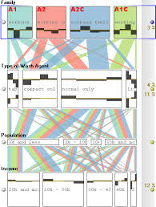{#fig-parsets}

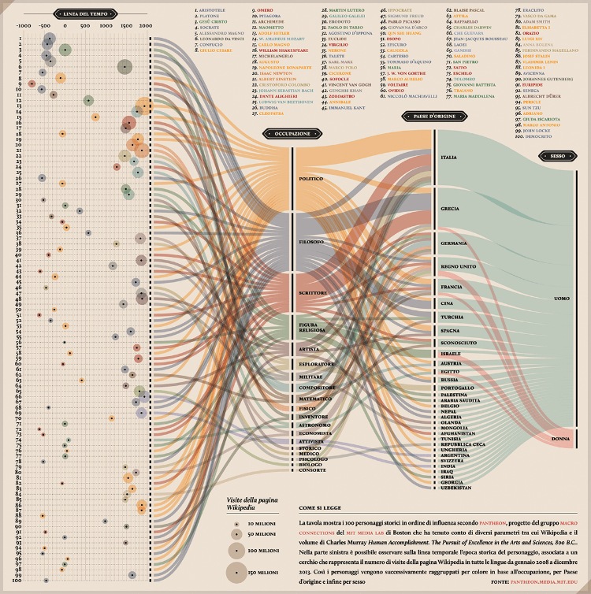{#fig-alluvial}

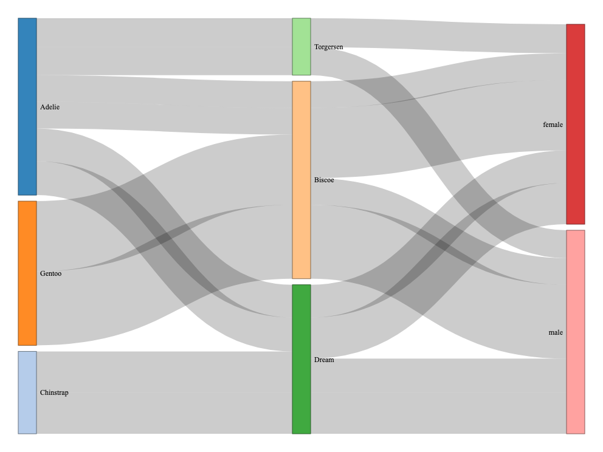{#fig-sankey}

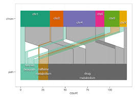{#fig-commonangle}

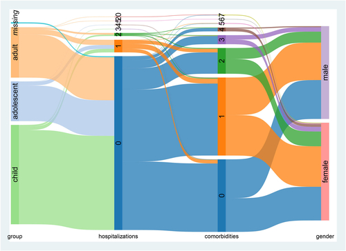{#fig-hammock}
:::

Categorical parallel-axis displays developed largely apart from classical PCPs, and for good reason: on a categorical axis, ties are not an occasional nuisance but the defining condition, since every observation in a level shares its position exactly. 
The dominant response was aggregation. 
Parallel Sets [@kosara2006] replaced individual polylines with ribbons whose widths encode bivariate frequencies, making density unambiguous at the cost of individual tracing (@fig-parsets). 
Alluvial diagrams [@brunson2020] and Sankey diagrams adopt the same ribbon-based representation (@fig-alluvial and @fig-sankey). 
Aggregation introduced its own perceptual problem, which common angle plots [@hofmann2013] addressed directly: the Müller–Lyer family of line-width illusions causes ribbon widths judged along the vertical to diverge systematically from their orthogonal widths, and constraining ribbons to a constant angle restores accurate frequency judgments (@fig-commonangle). 
Hammock plots [@schonlau2003; @schonlau2024] extend the aggregate approach to mixed data, accommodating categorical and continuous variables through constant-width parallelograms (@fig-hammock). 
The limitation is structural rather than incidental: because hammock plots show only bivariate relationships between adjacent axes, the full joint distribution cannot be reconstructed from them.

### Perceptual bounds on vertical displacement

How much spread is too much is a perceptual question before it is a geometric one, and the perceptual literature has a partial answer. 
The sine illusion, formalized by @day1991 and analyzed in the context of statistical graphics by @vanderplas2015, shows that vertical extent is not perceived neutrally: when segments of equal length are arrayed along a curve, those at extrema appear systematically longer than those at intermediate positions. 
The illusion belongs to the Müller–Lyer family that also underwrites the line-width distortion treated by @hofmann2013, and it predates the present work entirely; common angle plots were engaging with it by 2013, well before the generalized-PCP machinery this proposal builds on. 
Its relevance here is specific. 
A tie band that occupies too large a fraction of the resolution $\delta_j$ risks having its displacement, an artifact introduced for legibility, read as genuine variation in the data, and the risk is greatest where lines fan steeply out of a heavily-tied band. 
That is the perceptual case for an upper bound on within-band spread, and the reason $\sigma$ is held strictly below $1$: the provisional $\sigma = 0.9$ reserves the outermost tenth of each band against exactly this effect. 
It complements the just-noticeable-difference lower bound on the inter-band gap developed in @sec-math-step3, so that the two arguments bracket a defensible range for $\sigma$ from opposite directions. 
The existence of the upper bound is not in question; its magnitude is. 
Whether the sine illusion meaningfully affects within-band displacement for continuous, traceable lines is an empirical matter, and there are reasons to expect such lines may largely avoid it. 
Fixing the exact bound requires the calibration study specified as future work (@sec-evaluation); within the present work, the sensitivity analysis of @sec-evaluation characterizes computationally how layout quality varies with $\sigma$, bracketing the range in which that calibration would operate.

### Axis and category ordering

Line crossings are the dominant source of visual clutter in parallel coordinates, and the survey of Heinrich and Weiskopf [-@heinrich2013] devotes much of its treatment of clutter reduction to strategies for lowering their number; among these, reordering the axes is the most extensively developed, because a favorable order can remove crossings that no within-axis adjustment can. 
A well-studied property of PCPs is accordingly that axis order strongly affects both the number of line crossings and the interpretability of patterns [@vanderplas2023]. 
Minimizing line crossings through reordering is NP-hard in general [@murt2003], but heuristics based on correlation structure and sum of ranking differences provide tractable approximations [@ipkovich2021]. 
Tie-breaking introduces a second, distinct source of crossings: when tied observations have no intrinsic order, any arbitrary within-band arrangement adds crossings that the data did not require, and these can be removed by sorting rather than by reordering axes. 
The two mechanisms are complementary, and the sorting strategies developed in @sec-sorting operate within whatever axis order the analyst has chosen. 
Within a fixed axis ordering, the order of factor levels and the plotting order of individual observations interact with tie-breaking: factor levels ordered to minimize crossings produce fewer extraneous crossings for any given tie-resolution strategy.
Rendering order also matters: the `overplot` parameter in `ggpcp` controls which observations are rendered on top when lines overlap [@vanderplas2023]. 
These considerations interact directly with the hierarchical sorting approach from `ggpcp` which has been extended in this proposal.
This approach is discussed further in @sec-sorting.


### Computational quality metrics

Dennig et al. [-@dennig2021] formalized a suite of screen-space quality metrics for Parallel Sets, including ribbon overlap, crossing angle, orthogonality, and ribbon width variance; the suite is collectively named ParSetgnostics. 
These metrics provide an empirical basis for comparing and optimizing parallel axis layouts without requiring user studies, and are candidate measures for the computational benchmarking component of our evaluation plan.

# Categorical Variables and Ties {#sec-categorical-ties}

The `ggpcp` package currently addresses categorical ties through a combination of sorting and tie-breaking algorithms. 
The package implements hierarchical sorting through the `pcp_arrange(data, method, space)` function, which orders observations based on a hierarchical application of variable values. 
The `method` parameter determines the sequence in which variables are considered when resolving ties in the arrangement. 
The `space` parameter specifies the proportion of the y-axis dedicated to empty space between levels of categorical variables (@fig-categorical-fix).

```{r}
#| label: fig-categorical-code
#| echo: true
#| eval: false


# 1. Modular Data Pipeline (The correct Step 1, 2, 3)
# Note: 'pcp_data' is used here as a variable name for the transformed object.
pcp_data <- mtcars %>%
  mutate(across(c(cyl, am, gear, carb), as.factor)) %>%
  pcp_select(cyl, am, gear, carb) %>%     # Step 1: Reshape data
  pcp_scale(method = "uniminmax") %>%     # Step 2: Scale axes
  pcp_arrange(method="from-left")         # Step 3: Break Ties, 
                                          #         sorting from left
```

```{r}
#| label: fig-categorical-fix
#| message: false
#| echo: false
#| fig-subcap: ['Standard PCP, no tie breaking', 'GPCP, tie breaking, no sorting', 'GPCP, categorical ties, sorted from left', 'GPCP, categorical ties, sorted from right']
#| layout-ncol: 2
#| fig-cap: "Comparison of tie-breaking methods for categorical variables in parallel coordinate plots using mtcars data. Standard PCP (top-left) shows overlapping lines without tie-breaking. GPCP with tie-breaking but no sorting (top-right) spreads observations evenly within categories. GPCP with sorting from left (bottom-left) and from right (bottom-right) apply hierarchical sorting to minimize line crossings, with light gray boxes indicating category groupings."

library(ggpcp)
library(ggplot2)
library(dplyr)
library(patchwork)
# 1. Modular Data Pipeline (The correct Step 1, 2, 3)
# Note: 'pcp_data' is used here as a variable name for the transformed object.
pcp_data <- mtcars %>%
  mutate(across(c(cyl, am, gear, carb), as.factor)) %>%
  pcp_select(cyl, am, gear, carb) %>%           # Step 1: Reshape data
  pcp_scale(method = "uniminmax")         # Step 2: Scale axes

p0 <- pcp_data %>%
ggplot(aes_pcp()) +
  geom_pcp(aes(color = cyl), alpha = 0.6) + 
  geom_pcp_boxes(boxwidth = 0.1, fill = "white", alpha = 0.5) +
  geom_pcp_labels() +
  theme_pcp() +
  # labs(title = "Standard PCP", subtitle = "No Tie Breaking") + 
  guides(color="none")


# 2. Plotting with aes_pcp()
# Use aes_pcp() to automatically map the transformed pcp_x, pcp_y, and pcp_id variables.
p2 <- pcp_data %>%
  pcp_arrange("from-left") %>% # Sort from left
  ggplot(aes_pcp()) +
  geom_pcp(aes(color = cyl), alpha = 0.6) + 
  geom_pcp_boxes(boxwidth = 0.1, fill = "white", alpha = 0.5) +
  geom_pcp_labels() +
  theme_pcp() +
  # labs(title = "GPCP: Cat. Ties + Sorting", subtitle = "Sort from left") + 
  guides(color="none")


p3 <- pcp_data %>%
  pcp_arrange("from-right") %>% # Sort from right
  ggplot(aes_pcp()) +
  geom_pcp(aes(color = cyl), alpha = 0.6) + 
  geom_pcp_boxes(boxwidth = 0.1, fill = "white", alpha = 0.5) +
  geom_pcp_labels() +
  theme_pcp() +
  # labs(title = "GPCP: Cat. Ties + Sorting", subtitle = "Sort from right") + 
  guides(color="none")

pcp_data2 <- mtcars %>%
  mutate(across(c( cyl, am, gear, carb), as.factor)) %>%
  pcp_select(cyl, am, gear, carb) %>%
  pcp_scale(method = "uniminmax") %>%     # Step 2: Scale axes
  pcp_arrange("from-right") %>% # Sort from right
  # This shuffles everything within category, ensuring no sorting persists
  group_by(pcp_x, pcp_level) %>%
  mutate(order = permute::shuffle(n()),
         pcp_y = pcp_y[order],
         pcp_yend = pcp_yend[order])

p1 <-  pcp_data2 %>%
  # ungroup() %>%
  # pcp_arrange_opts(method="none", .by_group = F) %>% # No sorting - overwrote pcp_arrange()
  ggplot(aes_pcp()) +
  geom_pcp(aes(color = cyl), alpha = 0.6) + 
  geom_pcp_boxes(boxwidth = 0.1, fill = "white", alpha = 0.5) +
  geom_pcp_labels() +
  theme_pcp() +
  # labs(title = "GPCP: Tie Breaking", subtitle = "No sorting") + 
  guides(color="none")

p0
p1 
p2
p3
```


The ability to follow individual observations is key to being able to reconstruct the full joint distribution across parallel axes. 
`ggpcp` creates equally spaced points within each category that span the portion of the vertical axis dedicated to the category (preserving the marginal frequency information, which is optionally emphasized with `geom_pcp_boxes`). 
@fig-categorical-fix(a) shows a PCP without this categorical tie-breaking approach while @fig-categorical-fix(b) shows a PCP with tie-breaking but without sorting. 
`ggpcp` goes one step further by using hierarchical sorting (from the left, right, or both) to minimize unnecessary line crossings induced by the treatment of tied categorical variables. 
The importance of hierarchical sorting to the overall visual effect of the tie-breaking treatment of categorical variables is emphasized through the contrast between @fig-categorical-fix(b) and @fig-categorical-fix(c) and @fig-categorical-fix(d), which show sorting from the left and right respectively. 
Following @vanderplas2023, who distinguish crossings induced by the data from crossings induced by ordering, we call a line crossing necessary when the order of the axes and the scaled values induce it, and unnecessary when the tie-breaking treatment does. 
Hierarchical sorting removes the unnecessary crossings and leaves the necessary ones, reducing visual clutter.
The hierarchical sorting serves as a form of "external cognition," reducing the cognitive load required to "untangle" and mentally group crossed lines. 

How does a viewer actually follow one line through a plot with both kinds of axis? 
The next figures walk through it step by step, because the step at which the walk breaks down is the step this proposal is about.

::: {layout="[[30,-5,30,-5,30],[30,-5,30]]" .pcp-trace-grid}

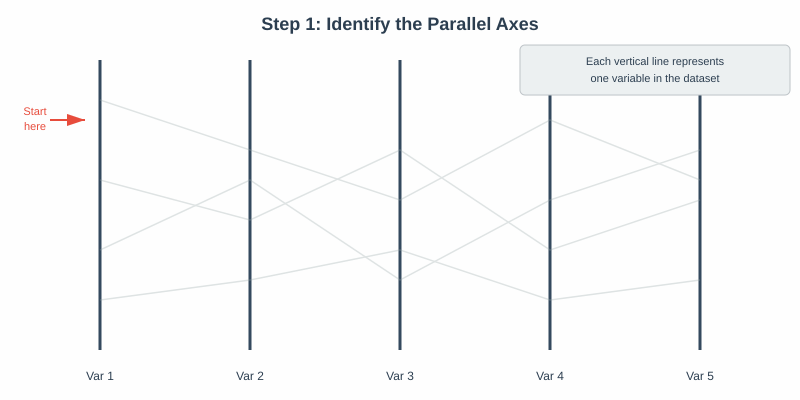{#fig-figure-1 width="90%"}

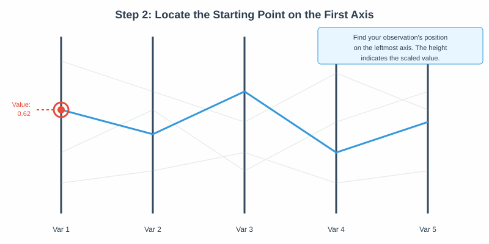{#fig-figure-2 width="90%"}

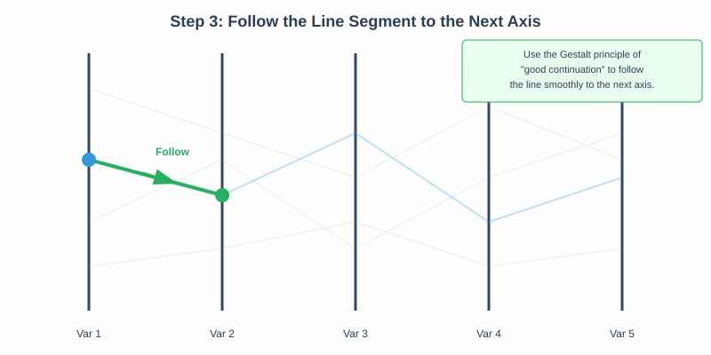{#fig-figure-3 width="90%"}

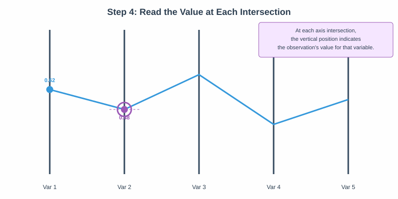{#fig-figure-4 width="90%"}

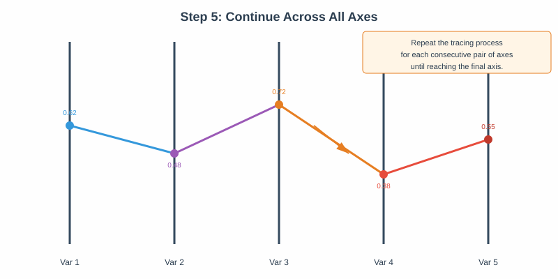{#fig-figure-5 width="90%"}

:::

```{=html}
<style>
.pcp-trace-grid figure { margin-right: 1.5em; margin-bottom: 1.2em; }
.pcp-trace-grid figcaption { padding: 0 0.75em; }
</style>
```
```{=latex}
\captionsetup[subfigure]{margin=0.75em}
```

```{r}
#| include: false

# This chunk is just to get the pdf that can be imported into Inkscape for generating the figure sequence...
my_mtcars <- mtcars %>%
  mutate(across(c(cyl, am, gear), as.factor)) %>%
  mutate(am = factor(am, levels = c(1, 0), ordered = T),
         inv_wt = -wt) 
pcp_data <- my_mtcars %>%
  pcp_select(cyl, am, mpg, qsec, inv_wt, gear, drat) %>%          
  pcp_scale(method = "uniminmax") %>%
  pcp_arrange()

p <- pcp_data %>%
  pcp_arrange("from-left") %>% # Sort from left
  ggplot(aes_pcp()) +
  geom_pcp(aes(color = cyl), alpha = 0.6) + 
  geom_pcp_boxes(boxwidth = 0.1, fill = "white", alpha = 0.5) +
  geom_pcp_labels() +
  theme_pcp() + 
  guides(color="none")
ggsave("images/pcp_orig_ggplot2.pdf", p, width=8, height=4, units="in")
```

```{r}
#| include: false
#| eval: false
#| 

# 1. Data Preparation
my_mtcars <- mtcars %>%
  mutate(across(c(cyl, am, gear), as.factor)) %>%
  mutate(am = factor(am, levels = c(1, 0), ordered = TRUE),
         inv_wt = -wt) 

pcp_data <- my_mtcars %>%
  pcp_select(cyl, am, mpg, qsec, inv_wt, gear, drat) %>%          
  pcp_scale(method = "uniminmax") %>%
  pcp_arrange()

# 2. Select exactly 6 rows to highlight
# You can slice(1:6) or select specific indices that show interesting bifurcations
highlight_lines <- pcp_data %>% 
  dplyr::slice(1:3) 

# 3. Create the Plot
pcp_data %>%
  pcp_arrange("from-left") %>% 
  ggplot(aes_pcp()) +
  # Background: All lines, heavily de-emphasized to clear the "wire-heavy" look 
  geom_pcp(aes(color = cyl), alpha = 0.05, size = 0.2) + 
  
  # THE HALO: Thicker white lines to separate the 6 traces from the background 
  geom_pcp(data = highlight_lines, 
           color = "white", 
           alpha = 0.8, 
           size = 2.5, 
           over = 0) +
  
  # THE TRACE: The 6 specific lines 
  # 'over = 0' ensures they don't merge/bundle, showing individual path splits 
  geom_pcp(data = highlight_lines, 
           aes(color = cyl), 
           alpha = 1, 
           size = 1.2, 
           over = 0) +
  
  # Structural elements: Boxes and Labels to anchor numerical ties 
  geom_pcp_boxes(boxwidth = 0.1, fill = "white", color = "gray90", alpha = 0.5) +
  geom_pcp_labels() +
  
  # Formatting
  scale_color_manual(values = c("4" = "#1f78b4", "6" = "#e31a1c", "8" = "#33a02c")) +
  theme_pcp() + 
  guides(color = "none") +
  labs(title = "Six-Path PCP Trace",
       subtitle = "Tracing specific observations to highlight multi-axis bifurcations")


```


- Step 1: Identify the Parallel Axes (@fig-figure-1).    
Begin by identifying each vertical axis in the plot. 
Each axis represents one variable from the dataset. 
The axes are typically arranged from left to right, and the order may be determined by the data analyst to highlight specific relationships or minimize visual clutter.

- Step 2: Locate the Starting Point (@fig-figure-2).    
Find the observation of interest on the leftmost axis. 
The vertical position indicates the scaled value of that observation for the first variable. 
If you are examining a highlighted or color-coded observation, look for its distinctive marker at this starting position.

- Step 3: Follow the Line Segment (@fig-figure-3).    
Trace the line segment from the starting point to its intersection with the next axis. 
The human visual system naturally follows smooth, continuous paths due to the Gestalt principle of good continuation, which allows viewers to perceive connected line segments as a single, piecewise continuous line, making it easier to track observations across multiple parallel axes.

- Step 4: Read Values at Intersections (@fig-figure-4).    
At each axis intersection, the vertical position of the line indicates the observation's value for that variable. Read these values to understand how the observation changes (typically, relative to the other observations) across different dimensions of the data. 
The slope of line segments between axes provides information about the relationship between consecutive variables for that specific observation.

- Step 5: Continue Across All Axes (@fig-figure-5).    
Repeat the tracing process for each consecutive pair of axes until reaching the rightmost axis. 
By following the complete path, you obtain a comprehensive view of how that particular observation behaves across all measured variables. 
The vertical positions along each axis represent scaled values that can be interpreted as quantiles when the data are appropriately transformed. 
This enables identification of unique characteristics, cluster membership, or outlier status.

{#fig-figure-6 width="90%"}

- Step 6: Ties in Numbers — A Fork in the Road (@fig-figure-6).

What was once a single point now becomes the starting point for two separate line segments that go in different directions. 
The Gestalt principle of good continuation doesn't work anymore when two or more lines come from the same point on an axis. 
In this configuration, color is the only channel that can provide separate line identity across the tie and even then, only when the palette is carefully chosen. 
The cyan/red separation failure in @fig-figure-6 also raises an accessibility concern that any color-dependent identity encoding inherits: hue distinctions that are marginal for typical trichromatic viewers can vanish entirely under the common forms of color-vision deficiency (deuteranopia and protanopia together affect roughly 8% of men), so a display whose tracing depends on hue alone excludes a non-trivial share of readers. 
Two design consequences follow for this work. 
First, all figures in this proposal use color-blind-safe palettes — the Okabe–Ito qualitative palette for discrete observation identities and the perceptually-uniform viridis family for continuous mappings — chosen so that adjacent lines remain separable under simulated dichromacy. 
Second, and more fundamentally, the tie-breaking algorithm is designed so that color is not load-bearing: positional separation within the band, the monotone cross-axis ordering, and the explicit tie-region cue (@sec-visual-cues) each carry observation identity through channels — position and enclosure — that are robust to color-vision deficiency, with hue retained as a redundant rather than sole encoding. 
The visual continuity that made tracing easy in earlier steps breaks down exactly where it is needed most. 
The observer cannot tell if the original observation follows the upper branch or the lower branch of the fork unless there are more visual cues, like color coding, clear labels, or a systematic tie-breaking arrangement. 
This lack of clarity is not just an aesthetic problem; it also makes it harder for the user to identify patterns that would be difficult to see in tabular data by following individual observations through high-dimensional space.
This ability to trace individual observations is one of the central reasons the improvements to PCPs in `ggpcp` are so effective.


```{r}
#| label: fig-working-theory
#| echo: false
#| fig-width: 9
#| fig-height: 4
#| fig-cap: "Comparison of a standard PCP with overlapping ties (left) and the proposed
#|   tie-breaking algorithm with `from-left` hierarchical sorting (right). Tied
#|   observations on Year B are spread within a resolution-based interval (blue boxes)
#|   and ordered by their Year A values, eliminating within-band crossings. A visible
#|   gap is preserved between the tie bands for 2000 and 2001: separation between bands
#|   is essential for the Gestalt grouping argument to hold, since adjacent bands that
#|   touch would visually merge and the reader would lose the ability to distinguish
#|   distinct values. The band width is therefore set strictly below the global axis
#|   resolution $\\delta_j$; this illustration uses $\\sigma = 0.55$ so that the
#|   inter-band gap is unambiguous at figure size, and the choice of a default
#|   $\\sigma$ is taken up in @sec-defaults. Remaining crossings are necessary
#|   crossings induced by the data structure rather than artifacts of tie-breaking."

library(ggplot2)
library(dplyr)
library(patchwork)

# ── 1. Raw data ───────────────────────────────────────────────────────────────
raw <- tibble(
  id    = 1:18,
  yearA = c(1990, 1991, 1993, 1995, 1996, 1997,
            1998, 1999, 2000, 2001, 2002, 2003,
            2003, 2004, 2004, 2005, 2006, 2007),
  yearB = c(1980, 1980, 1980, 1980, 1980, 1980,
            2000, 2000, 2000, 2000, 2000, 2000,
            2001, 2001, 2001, 2001, 2001, 2001),
  value = c(15,   40,   60,   25,   80,   50,
            35,   70,   20,   90,   45,   65,
            30,   55,   85,   10,   75,   95)
)

# ── 2. Scale to [0, 1] ────────────────────────────────────────────────────────
s01 <- function(x) (x - min(x)) / (max(x) - min(x))
dat <- raw %>% mutate(sA = s01(yearA), sB = s01(yearB), sV = s01(value))

# ── 3. Axis resolution & spread width ────────────────────────────────────────
# A visible gap between adjacent tie bands is essential for the Gestalt argument:
# bands that touch at the 2000/2001 boundary would visually merge, collapsing the
# very separation the reader is meant to perceive. We therefore take the band
# width as a fraction of the global axis resolution, leaving the remainder as gap.
uB         <- sort(unique(dat$sB))     # scaled positions: 1980, 2000, 2001
delta      <- min(diff(uB))            # smallest gap between distinct values (2000–2001)
band_frac  <- 0.55                     # sigma for this illustration: band occupies 55% of delta,
                                       # 45% remains as gap (the provisional default sigma = 0.9 is
                                       # discussed in the Implementation section)
spread     <- delta * band_frac

# ── 4. From-left tie-breaking on Year B ───────────────────────────────────────
dat_broken <- dat %>%
  group_by(sB) %>%
  arrange(sA, .by_group = TRUE) %>%
  mutate(
    n    = n(),
    rank = row_number(),
    lo   = pmax(0,  sB - spread / 2),
    hi   = pmin(1,  sB + spread / 2),
    sBk  = if_else(n == 1L, sB, lo + (rank - 1L) / (n - 1L) * (hi - lo))
  ) %>%
  ungroup()

# ── 5. Long format ────────────────────────────────────────────────────────────
to_long <- function(d, broken = FALSE) {
  yB <- if (broken) d$sBk else d$sB
  bind_rows(
    tibble(id = d$id, x = 1, y = d$sA),
    tibble(id = d$id, x = 2, y = yB),
    tibble(id = d$id, x = 3, y = d$sV)
  )
}
long_before <- to_long(dat,        broken = FALSE)
long_after  <- to_long(dat_broken, broken = TRUE)

# ── 6. Colors (color-blind safe) ───────────────────────────────────────────
obs_cols <- c(
  "1" = "#E69F00", "2" = "#56B4E9", "3" = "#009E73",
  "4" = "#CC79A7", "5" = "#0072B2", "6" = "#D55E00"
)

# ── 7. Year B reference: breaks and labels for the secondary axis ─────────────
yB_breaks <- uB
yB_labels <- c("1980", "2000", "2001")

# ── 8. Tie boxes (after panel only; every value shared by >1 observation) ─────
tie_boxes <- dat_broken %>%
  group_by(sB) %>%
  filter(n() > 1) %>%
  summarise(lo = first(lo), hi = first(hi), .groups = "drop") %>%
  transmute(xmin = 1.87, xmax = 2.13, ymin = lo, ymax = hi)

# ── 9. Shared theme ───────────────────────────────────────────────────────────
pcp_theme <- theme_bw(base_size = 10) +
  theme(
    panel.grid         = element_blank(),
    axis.text.y.left   = element_blank(),
    axis.ticks.y.left  = element_blank(),
    axis.title         = element_blank(),
    plot.title         = element_text(size = 10, face = "bold", hjust = 0.5),
    # Secondary axis: Year B reference labels, rendered in the right margin
    axis.text.y.right  = element_text(size = 7.5, colour = "grey35"),
    axis.ticks.y.right = element_line(colour = "grey50", linewidth = 0.3),
    axis.title.y.right = element_text(size = 8, colour = "grey40",
                                       angle = 270, vjust = 0.5)
  )

# ── 10. Plot factory ──────────────────────────────────────────────────────────
make_pcp <- function(long, title, boxes = NULL) {

  p <- ggplot(long, aes(x, y, group = id, colour = factor(id))) +
    # Tie boxes drawn first so lines render on top
    geom_vline(xintercept = c(1, 2, 3), colour = "black", linewidth = 0.5) +
    geom_line(linewidth = 0.8, lineend = "round") +
    scale_colour_manual(values = obs_cols, guide = "none") +
    scale_x_continuous(
      breaks = 1:3,
      labels = c("Year A", "Year B", "Value"),
      limits = c(0.55, 3.45),
      expand = c(0, 0)
    ) +
    # Primary y-axis: unlabeled (PCP convention)
    # Secondary y-axis: Year B reference — rendered in the margin, never overlaps lines
    scale_y_continuous(
      limits   = c(-0.05, 1.05),
      expand   = c(0, 0),
      breaks   = NULL,
      sec.axis = sec_axis(
        transform = ~ .,
        breaks    = yB_breaks,
        labels    = yB_labels,
        name      = "Year B"
      )
    ) +
    # Small tick marks on the Year B axis itself for visual anchoring
    annotate("segment",
             x = 1.97, xend = 2.03,
             y = yB_breaks, yend = yB_breaks,
             colour = "grey40", linewidth = 0.45) +
    labs(title = title) +
    pcp_theme

  if (!is.null(boxes)) {
    p <- p + geom_rect(
      data      = boxes,
      aes(xmin = xmin, xmax = xmax, ymin = ymin, ymax = ymax),
      inherit.aes = FALSE,
      fill      = "#AED6F1",
      colour    = "#2471A3",
      alpha     = 0.35,
      linewidth = 0.5
    )
  }

  p
}

p_before <- make_pcp(long_before, "Before: Exact Values")
p_after  <- make_pcp(long_after,  "After: From-Left Sorting", tie_boxes)

p_before + p_after
```

Two implementation details in @fig-working-theory deserve explicit comment because both are load-bearing for the Gestalt argument that motivates the development of a similar tie-breaking approach for numerical axes.
First, each tie band must be narrower than the gap to its nearest neighbor: if the band around $v = 2000$ extended up to meet the band around $v = 2001$, the two values would visually fuse, defeating the separation the spread was meant to make visible. 
The band width in the figure is therefore set to a fraction of the variable resolution $\delta_j$, leaving a deliberate gap between adjacent bands. 
Second, the reader must be able to see that gap, not merely have it exist in the coordinate system. 
This is a Gestalt-of-proximity requirement: the gap must lie above the just-noticeable-difference (JND) threshold and so cannot be shrunk to an infinitesimally small size. 
If ties at adjacent values are rendered without a perceptible gap, the grouping cue that "observations within a band share a value" competes with the unintended cue that "bands adjacent to one another belong to the same group." 
The mathematical formalization of this separation requirement appears in Step 3 of the algorithm (@sec-math-step3).
In practice, this restriction is handled through a warning: `pcp_spread_ties()` reports when the inter-band gap $(1-\sigma)\,\delta_j$ falls below a threshold, `min_gap`, set by default to 0.005 of the axis (@sec-defaults).


The `ggpcp` package implements a tie-breaking algorithm for categorical variables that maintains individual observation traceability by spacing observations evenly within each categorical level:

> "All observations are spaced out evenly. This results in a natural visualization of the marginal frequencies along each axis (additionally enhanced by the light gray boxes grouping observations in the same category) that is not as prominent in the previous three panels. The ordering of the observations within the level is such that a minimal number of line crossings occurs between the axes." (p. 11)

This even spacing within an axis category allows the box height to function as a representation of the marginal proportion of the category relative to the whole.
The sorting is hierarchical not as a stylistic choice but out of necessity: the levels must be processed in order for the arrangement to reduce line crossings across the plot as a whole.
Without hierarchical sorting from the axis out to neighboring axes, lines departing toward different positions on the neighboring axis could cross *inside* the band.

This hierarchical sorting approach is the subject of @sec-sorting; the spacing formula used for categorical levels is

$$d_i = \frac{S_i - S_i^- - S_i^+}{n_i - 1},$$

where:

-   $S_i$ is the total space allocated to category $i$
-   $S_i^-$ is the spacing below category $i$
-   $S_i^+$ is the spacing above category $i$
-   $n_i$ is the number of observations in category $i$
-   $d_i$ is the optimal spacing distance between consecutive observations.

![Spacing parameters for a categorical axis. Each level $i$ is allocated total height $S_i$, with margins $S_i^+$ above and $S_i^-$ below reserved for inter-level separation. The remaining vertical extent is divided into $n_i - 1$ intervals to seat $n_i$ observations at uniform spacing $d_i$. The parameter-key panel on the right indicates how each quantity is determined: $S_i$ is set by the level's frequency proportion under a user-chosen total budget, $S_i^\pm$ are user-controlled via the `space` argument, $n_i$ is the level frequency, and $d_i$ is derived from the formula at the bottom. The numerical analog of this figure (@fig-figure-7) shares the same layout, color encoding, and formula structure; the differences are confined to how each parameter is set.](images/pcp_line_tracing_guide_images/spacing_categorical.png){#fig-spacing width="90%"}

The spacing formula above is the categorical workhorse: each level $i$ is allocated total height $S_i$, lower and upper margins $S_i^-$ and $S_i^+$ are subtracted to enforce inter-level separation, and the remaining vertical extent is divided into $n_i - 1$ intervals to seat $n_i$ observations.
The proposed numerical framework adopts the same five quantities and the same formula structure, redefining only what determines each parameter; the full mapping is given in @sec-unified (@tbl-unified).
@fig-figure-7 displays the numerical version using the same parameter-key conventions as @fig-spacing, so the two figures can be laid side by side and read as a single procedure with type-specific instantiations rather than as two separate algorithms that happen to share an idea.


A key visual difference emerges when connecting categorical to numerical variables.
As @schonlau2024 observe in their comparison of the two displays, when many observations share a value on a categorical variable and on the adjacent numerical variable, the region spanning the two axes takes on a triangular shape, and the concentration of cases flowing from a single category into a small set of adjacent values reads far more readily in a hammock plot than in a GPCP.

Whether the transition takes a triangular or rectangular form is perhaps less important than what it communicates about the data itself. 
The more interesting question is whether the visualization preserves density information while still allowing viewers to follow individual observations. 
When observations flow from a categorical box toward numerical values, tie-breaking on the numerical axis shapes how clearly we can perceive the underlying distribution.

The `ggpcp` tie-breaking parameters, `method` and `space`, act on variables that are handled as categorical levels.
To spread ties on a numeric variable in the published package, a user coerces it to a factor. 
For a variable with a handful of integer levels, that is the right treatment: the levels are few and usually equally spaced, and frequency-proportional boxes give the histogram reading a viewer expects from such a variable. 
For a variable with many distinct values and scattered ties, coercion replaces the metric scale with dozens of equally-spaced levels, so axis position no longer reflects magnitude or the gaps between values, and the boxes become slivers. 
Hammock plots make a different trade, showing marginal densities directly through constant-width parallelograms while individual tracing requires highlighting. 
The proposed extension keeps the variable numeric: individual lines stay intact, each tied value is marked by a band of fixed height at its true position, and the number of observations at the value is carried by a label rather than by the band's height. 
@sec-novelty states where each treatment applies.

The preceding review of categorical tie-breaking, together with the related work in @sec-related-work, sets the stage for a formal specification of the approach to numerical ties in this proposal detailed in @sec-rq.


# Approach {#sec-rq}

The question the rest of this document answers is a simple one: what, exactly, is being claimed, and how will anyone know whether it is true? 
This section states the proposal proper: the research questions the dissertation addresses, the contributions it claims, the plan for implementation and defaults, and the design of the evaluation.
The technical development that these questions build on the `tie_spread` algorithm, its mathematical specification, the visual-cue design, and preliminary visual results is presented in @sec-numerical.
@sec-numerical should therefore be read as the developed method on which the proposal rests, now implemented in `ggpcp` as `pcp_spread_ties()`; the subsections below set out what is built and what remains to be built, defaulted, and empirically tested.

## Research Questions and Contributions {#sec-questions}

The dissertation is organized around three research questions.

*RQ1 (representation).* Can tied observations on a numerical axis be spread so that, simultaneously, (a) the metric ordering and approximate spacing between distinct values are preserved, (b) the number of observations at each tied value remains recoverable, and (c) individual observations remain traceable across the plot? 
@sec-numerical develops a resolution-anchored construction intended to satisfy all three. 
Property (a) holds by construction (@prp-metric); the dissertation verifies the structural preconditions of (b) and (c) computationally, confirming that within-band crossings are eliminated and characterizing when within-band legibility saturates. 
Whether viewers can in fact trace observations through spread ties, and see the gaps the spread preserves, is tested in the viewer study (@sec-viewer-study); the comparison against hammock plots on frequency judgments is specified as future work (@sec-future-perceptual).

*RQ2 (defaults).* What default value of the separation parameter $\sigma$, and what default visual-cue design, produce the best trade-off between the legibility of individual lines and the faithful perception of density and of the gaps between adjacent values? 
The provisional default $\sigma = 0.9$ is not yet empirically justified, and the perceptual bounds that would justify it (the just-noticeable-difference lower bound on the inter-band gap and any sine-illusion upper bound on within-band spread, @sec-related-work) are open. 
The composition of the cue is open as well: the box is the provisional default, and the perceptual case against drawing it on a numeric axis is set out in @sec-visual-cues.

*RQ3 (comparative value).* Does numerical tie-breaking improve the judgments viewers actually make on integer-heavy data, relative to what a user does with such an axis today, leaving the values exact or jittering them, and, at the boundary with the few-levels regime, relative to coercing the variable to a factor (@sec-novelty)? 
The answer is not expected to be uniform. 
Exact values give up tracing through a tie; jitter separates the lines but at random, with crossings inside the tie and no bound on the displacement; coercion gives up the metric scale in exchange for a length encoding of frequency. 
The method should therefore help on tracing, the task parallel coordinate plots are read for, and on reading counts through its label, and its fixed-height band should cost accuracy on frequency judgments only where coercion's box height is the alternative. 
The question is perceptual, and the dissertation answers it with viewers (@sec-viewer-study). 
The broader comparison against hammock plots and against GPCPs without tie-breaking, on synthetic data spanning the $(\sigma, \delta_j, k)$ grid, is specified as future work (@sec-future-perceptual).

The proposed contributions are correspondingly: (1) the `tie_spread` algorithm: a resolution-anchored allocation for ties on numeric axes, the regime boundary that says where it applies and where the published categorical treatment does (@sec-novelty), and its formal unification with that treatment (@sec-unified); (2) an implementation in `ggpcp`, `pcp_spread_ties()`, whose tidyselect `vars` argument lets users apply spreading per-axis while preserving exact positioning on others; (3) a visual-cue grammar, `geom_pcp_tieboxes()`, the numerical analog of `geom_pcp_boxes` and `geom_pcp_labels`, in which the band marks the tie and a count label carries the frequency the band cannot; (4) a computational benchmarking framework that adapts the ParSetgnostics metrics of @dennig2021 to individual-line displays, verifies the within-band crossing guarantee, and quantifies the sensitivity of layout quality to $\sigma$, $\delta_j$, and tie multiplicity; and (5) a viewer study comparing `tie_spread` with exact values, jitter, and, at the regime boundary, factor coercion on real integer-heavy data, together with a fully specified design for the larger perceptual evaluation and $\sigma$ calibration as future work.

## Implementation and Sensible Defaults {#sec-defaults}

The grammar of graphics is built on the idea of smart defaults that can be customized when necessary.
In `ggpcp`, categorical tie-breaking is supported by `geom_pcp_boxes` and `geom_pcp_labels`, which supply sensible visual cues for categorical levels.
Three parameters require principled defaults for the numerical case: the axis resolution, which sets the band height; the separation parameter $\sigma$, which governs how much of each band is used for spreading versus reserved as an inter-band gap; and the visual-cue rendering, including whether tie boxes are drawn, whether they carry the original value and the count of observations, and whether boxes are suppressed below a tie-count threshold (`min_n`) to reduce clutter.

The resolution follows the convention of `ggplot2`, whose bar and box geoms take their default width from the resolution of the data, as computed by `resolution()`, and let the user override it. 
`pcp_spread_ties()` takes the smallest difference between adjacent distinct values as its default. 
For a variable stored as a double, that is what `resolution()` returns; for one stored as an integer, `resolution()` returns 1 whatever the gaps, and the smallest gap is the one used here. 
The same override, a `resolution` argument in data units, is specified and remains to be built; with it, a variable recorded on a coarser or finer grid than its smallest observed gap suggests is set by hand (@sec-math). 

Diagnostics, not the default, handle the hard cases, and two of the three are built. 
`pcp_spread_ties()` warns when the inter-band gap $(1-\sigma)\,\delta_j$ falls below `min_gap`, 0.005 of the axis by default, because adjacent bands may then merge visually. 
It warns when the spacing between tied observations inside a band falls below `min_spacing`, 0.001 by default, because the band is then saturated and its observations overplot (@sec-math). 
Both thresholds are provisional in the same sense as $\sigma$. 
At $\sigma = 0.9$ the first warning fires whenever $\delta_j < 0.05$, that is, on any axis whose range spans more than twenty grid steps; it fires on every axis of `iris`, and the package vignette acknowledges it there by setting `min_gap = 0`. 
The many-valued regime the method is built for therefore triggers the warning at the provisional defaults, and the pairing of $\sigma$ with `min_gap` is part of what RQ2 must settle. 
The third diagnostic accompanies the `resolution` argument and remains to be built: when the smallest gap on an axis is far below the typical gap, which signals a data anomaly or mixed precision, the software reports the axis and the values involved and recommends an override or coercion.

The provisional default $\sigma = 0.9$ reserves $10\%$ of the resolution band as a gap.
It is provisional precisely because the two perceptual bounds that bracket a defensible value are not yet established: the gap must remain above the just-noticeable-difference threshold so that adjacent bands are not read as a single value (@sec-math-step3), while the spread should remain small enough that within-band displacement is not misread as genuine variance.
The empirical calibration of $\sigma$ with human observers, varying $\sigma$ over a grid at several axis resolutions $\delta_j$ and tie multiplicities $k$, and selecting the largest $\sigma$ that keeps band-separation errors below a pre-set threshold, is specified as future work (@sec-evaluation). 
Within the dissertation, the same $(\sigma, \delta_j, k)$ grid is exercised computationally: the sensitivity analysis of @sec-evaluation quantifies how the adapted layout-quality metrics respond to $\sigma$ across resolutions and multiplicities, identifying the region where quality is stable (making the eventual calibrated choice forgiving) and the region where it degrades sharply (where calibration precision will matter most).

Implementation proceeds in three phases, and the first is complete.
Phase 1 built the core `tie_spread` algorithm as `pcp_spread_ties()`, a fourth data-wrangling step after `pcp_select()`, `pcp_scale()`, and `pcp_arrange()`. 
It covers the three processing modes, the separation parameter `sigma`, clamped bands, the per-axis tidyselect interface (`vars`), and the two diagnostics above; `pcp_arrange_unified()` runs the categorical and numerical steps in one call. 
The cue is built as well: `pcp_tie_boxes()` and `geom_pcp_tieboxes()` draw the boxes, their value labels, and their count labels (@sec-visual-cues).
Phase 2 adds what remains of the specification: the `resolution` argument and its diagnostic, unit tests, and reference documentation.
Phase 3 documents the provisional defaults together with the sensitivity-analysis evidence supporting them, so that the future calibration study can refine rather than establish them.
The package vignette, *Breaking ties on numeric axes*, exercises the built components on `iris`, the flea beetle data, and the Palmer penguins.

The first public presentation of the work is planned for the 2027 Symposium on Data Science and Statistics (SDSS; Pittsburgh, April 27–29, 2027), as a refereed submission in the Data Science Applications track. 
The submission, a 2,000-character abstract and a two-page blinded extended abstract, is due November 30, 2026, with decisions expected in early January 2027. 
It reports the `tie_spread` algorithm, its unification with the categorical tie-breaking in `ggpcp`, and the applications to the Palmer penguins (@fig-uniform-spacing) and flea beetle (@fig-flea-coercion) data. 
An abstract not accepted as a refereed talk may still be considered for a lightning session. 
Before the submission, a design pilot of the tracing task (@sec-viewer-study) is run with volunteer colleagues on the flea stimuli, so that the abstract's claim about tracing rests on a first observation rather than on argument alone; the pilot fixes the task's difficulty and is not reported as a result. 
The months between submission and the symposium coincide with the computational benchmarking of @sec-evaluation and the pilot of the viewer study (@sec-viewer-study), so the talk can report results on within-band crossings and on the sensitivity of layout quality to $\sigma$, and the pilot's first comparison against factor coercion. 
The methods paper, drawn from @sec-numerical and the computational results of @sec-evaluation, is planned for the *Journal of Data Science, Statistics, and Visualisation* (JDSSV), the open-access journal of the International Association for Statistical Computing. 
The journal's scope names the visualisation of data directly, it charges no author fees, and it requires the code and data that reproduce a paper's results to accompany the submission, a requirement the `ggpcp` extension meets by construction. 
Its stated target of three months from submission to decision allows a June 2027 submission to return a decision before the dissertation is circulated to the committee. 
Refereed SDSS presenters may also submit to the *Journal of Data Science*, which is retained as the alternative venue should JDSSV decline the paper. 
IEEE VIS, the venue named in the March draft, is retained in two forms. 
A short paper to VIS 2027 (four pages plus references; the 2026 deadline was April 30, with notification in June) can carry the benchmarking results and the viewer-study pilot, and the decision to submit is taken in April 2027 once the main study's timing is known. 
A full paper to VIS 2028, published in *IEEE Transactions on Visualization and Computer Graphics*, can carry the complete viewer study after the defense; its deadline falls in late March, so a dissertation defended in November 2027 meets it without compressing the evaluation.

## Evaluation {#sec-evaluation}

A method can be specified exactly, proved to do what it says, and still be worth nothing to the person looking at the plot. 
The evaluation is built to find out which of those this one is. 
It has two parts. 
The first is computational: an adaptation of established screen-space quality metrics to individual-line displays, a verification of the within-band crossing guarantee, and a sensitivity analysis of layout quality over the algorithm's parameters. 
Computation can show that a layout has the properties claimed for it; it cannot show that viewers benefit from them. 
The second part is therefore a viewer study (@sec-viewer-study), deliberately narrow: one real integer-heavy dataset, the comparison a `ggpcp` user would actually face, against factor coercion, and three tasks. 
Hammock plots [@schonlau2003; @schonlau2024] remain the natural comparator for density, since they make the opposite trade-off to GPCPs, encoding aggregate density through constant-width boxes while supporting individual tracing only through highlighting; the larger study that compares against them, together with the empirical calibration of $\sigma$, is specified as future work (@sec-future-perceptual).

**Metric adaptation.** 
We compare layouts using the screen-space quality metrics of @dennig2021. 
Not all transfer: crossing count and crossing angle apply directly to individual-line GPCPs, whereas ribbon-overlap and ribbon-width-variance are defined for ribbon plots and have no direct analog. 
We therefore substitute line-level measures, overplot/line-overlap density and within-band crossing count, and add a band-separation measure recording whether the rendered gap between adjacent tie bands remains above a fixed pixel threshold, the computational proxy for the just-noticeable-difference requirement of @sec-math-step3. 
A further measure, absent from @dennig2021 because ribbon displays have no metric axis, records *metric fidelity*: the rank correlation between the true gaps between adjacent distinct values and the rendered distances between their band centers. 
`tie_spread` reproduces those gaps by construction, since band centers sit at the true values, so the measure quantifies how far the coercion condition departs from them and is the computational counterpart of the viewer study's magnitude tasks. 
The adapted suite is applied to five display conditions (hammock, GPCP with exact values, GPCP with jitter, GPCP with the variable coerced to a factor, and GPCP with `tie_spread`) on common datasets, extending the qualitative box-shape comparison of @schonlau2024 to a quantitative, reproducible layout comparison.

**Within-band crossing verification.** 
The central structural claim of @sec-sorting, that hierarchical sorting eliminates within-band crossings entirely, so that all remaining crossings are induced by the data rather than by tie-breaking, is verified computationally by counting within-band crossings across the benchmark suite, under all three processing modes and at every combination of the sensitivity grid below. 
The expected count is exactly zero in every cell; any nonzero count falsifies the implementation rather than the theory, making this component a machine-checkable correctness test as well as an evaluation result.

**Sensitivity analysis.** 
The third component quantifies how layout quality responds to the quantities a user or the algorithm controls: the separation parameter $\sigma$ (over a grid in $(0, 1]$ including the provisional $0.9$), the axis resolution $\delta_j$ (varied through synthetic data construction from coarse integer-valued axes to near-continuous ones), and the tie multiplicity $k$ (from small ties through the saturation regime identified in @sec-math). 
Stimuli are generated from controlled synthetic datasets crossing these factors, supplemented by real integer-heavy data for ecological validity: the flea beetle data of @fig-flea-coercion for the many-valued regime, the penguins for fine-grid measurements, and the asthma data of @schonlau2024 for the few-levels, high-multiplicity regime in which the band saturates. 
For each cell of the grid, the adapted metric suite is computed, yielding response surfaces for overlap density, total crossings, band-separation, and within-band dot spacing $\Delta(v)$ against the saturation threshold of @sec-math. 
Three outputs matter: the region of $(\sigma, \delta_j, k)$ over which quality metrics are stable, which indicates how forgiving the eventual calibrated default can be; the location and sharpness of the degradation boundary, which is where the future perceptual calibration will need its precision; and the empirical confirmation that the closed-form saturation prediction $k^\star$ from the high-multiplicity analysis matches where overlap actually reappears. 
This analysis stands on its own as a characterization of the method's operating envelope, and it directly scopes the future calibration study by identifying which parameter regions are worth human-subject trials at all.

### Viewer study: `tie_spread` against the treatments a user has {#sec-viewer-study}

The viewer study asks whether `tie_spread` helps viewers more than what they would otherwise do with a many-valued numeric axis. 
The comparison is set in the regime where the method applies (@sec-novelty), against the treatments a user actually has there, and it is designed to answer one question clearly rather than several partially.

**Data and conditions.** 
Stimuli are drawn from the four many-valued measurements of the flea beetle data (`tars1`, `tars2`, `aede1`, `aede3`; 33 to 46 distinct values each; @fig-flea-coercion). 
The main block has three conditions: *exact values*, with no tie-breaking; *jitter*, at `ggplot2`'s default of a uniform offset within 40% of the axis resolution; and *`tie_spread`* at the provisional $\sigma = 0.9$ with its default cue, the box, the value label, and the count label. 
Factor coercion is not a condition in this block, because no user would apply it to an axis with 46 values and @fig-flea-coercion already shows what it does there. 
It is tested where the choice is live: a *boundary block* uses `head`, which takes 13 distinct values, and compares coercion with `tie_spread` drawn without the count label, so that the fixed-height band is measured against the frequency-proportional box on the band's own terms. 
All conditions share axis order and species colors, and `from-left` sorting where the treatment has an ordering to apply. 
Varying the axis order and the observations highlighted yields distinct stimuli from a single dataset.

The asthma data of @schonlau2024, which the March draft used against hammock plots, are not used here. 
Their two numeric variables take seven and eight distinct values over 696 patients, with hundreds of observations on the common values: the few-levels regime, at multiplicities where a band saturates (@sec-math). 
They remain the stimuli for the hammock comparison in the future perceptual study (@sec-future-perceptual), since they are the hammock plot's own showcase and @schonlau2024 discuss the categorical and numerical treatments of the hospitalizations axis directly, and they are the saturation case in the sensitivity analysis.

**Tasks.** 
The tasks are the ones parallel coordinate plots are read for, consistent with the position taken in @sec-categorical-ties that values on a PCP axis are read as approximate relative positions, not exact magnitudes. 
In the main block: 
(1) *tracing*: a highlighted observation is marked on one axis, and the participant reports whether it takes the upper or lower of two marked positions on the next axis; and 
(2) *frequency comparison*: given two marked values on an axis, which is shared by more observations. 
The boundary block adds (3) *gap detection*: on a highlighted axis, which observation, if any, stands apart from the rest, with the answer defined from the raw data; this is the task on which coercion's loss of the metric scale should show.

**Hypotheses.** 
*V1 (tracing, main block):* accuracy is ordered `tie_spread` > jitter > exact values. Exact values make tracing through a tie impossible by construction; jitter separates the lines but orders them at random, so lines cross inside the tie; `tie_spread` orders them by the next axis (@prp-crossings). 

*V2 (frequency, main block):* accuracy is ordered `tie_spread` > jitter > exact values, and the advantage is attributable to the count label, since the band and the jitter cloud both convey frequency only through how densely they are filled. 

*V3 (boundary block):* on tracing and gap detection, `tie_spread` is at least as accurate as coercion; on frequency comparison, coercion is at least as accurate as `tie_spread` without its count label. 

V3 is stated against the method on purpose. 
A frequency-proportional box is a length and a fixed-height band is not, and the boundary block is where that cost can be measured, because it is the one regime in which coercion is a treatment a user would apply. 
The claim the study can support is therefore in two parts: in the many-valued regime, `tie_spread` improves on what users do today; at the boundary, it matches coercion on tracing and gap detection and the size of the V3 effect states what the band alone costs on frequency judgments.

**Design pilot.** 
A design pilot of the tracing task in the main block precedes the SDSS submission (@sec-defaults): about ten volunteer colleagues, the flea stimuli, all three conditions, twenty trials each. 
Its purpose is to fix the difficulty of the task, confirm that the stimuli can be read in the time allotted, and give a first observation of the direction of V1. 
It is conducted under the department's provisions for instrument pilots, it informs the design and the committee's discussion, and it is not reported as a result of the study.

**Design and analysis.** 
Both blocks are within-subjects on condition and task. 
Stimuli are assigned to conditions by a Latin square, so that each participant sees each stimulus once and every condition equally often. 
Participants are recruited online, complete a short tutorial on reading PCPs with practice trials and feedback in every condition, and answer embedded attention checks. 
Accuracy is the primary outcome, analyzed separately for each task with a mixed-effects logistic regression carrying a fixed effect of condition, planned contrasts for the orderings in V1 and V2, random intercepts for participant and stimulus, and a random slope of condition by participant; response time is secondary. 
A pilot of about 20 participants, run under institutional review, estimates effect sizes and variance, from which a simulation-based power analysis fixes the sample size; the planning figure is about 100 participants. 
The protocol is submitted for institutional review before that pilot, and the design, hypotheses, and analysis are pre-registered on OSF before the main collection.

**What the study does not answer.** 
One dataset does not establish generality, and jitter is tested at one setting. 
The comparison against hammock plots, the use of synthetic data spanning the $(\sigma, \delta_j, k)$ grid, ratio tasks, and the calibration of $\sigma$ remain future work (@sec-future-perceptual). 
The viewer study answers the prior question, whether the method is worth that larger study.

### Future work: perceptual evaluation and calibration {#sec-future-perceptual}

The larger perceptual study is specified here in full so that it can be executed and pre-registered without further design work. 
It extends the viewer study of @sec-viewer-study in four directions: to hammock plots as a comparator, to synthetic data spanning the $(\sigma, \delta_j, k)$ grid, to ratio tasks and the effect of the count label on frequency judgments, and to the composition of the cue, the box against the labels alone (@sec-visual-cues). 
Exact values, jitter, and factor coercion are retained as conditions, so that the results of the two studies can be compared directly.

**Tasks.** 
We adopt four task types drawn from the elementary graphical-perception tasks used in the visualization literature: (1) *magnitude estimation*, how many observations take a given value on an axis; (2) *ordinal comparison*, which of two values, or which of two bands, holds more cases; (3) *ratio / proportion*, what fraction of the cases in a category flow to a given adjacent value; and (4) *tracing*, whether a highlighted observation takes the upper or lower value at the next axis, which probes the traceability claim directly. 
A fifth task is specific to the cue: (5) *same-value judgment*, whether two highlighted observations on an axis share a value, which probes whether displacement inside a band is read as artifact.

**Hypotheses.** 
*H1:* on the density tasks (1–3), GPCP-with-tie-breaking is not worse than the hammock plot and both are better than GPCP-without, i.e. tie-breaking closes the density gap that motivates the work. 

*H2:* on the tracing task (4), GPCP-with-tie-breaking outperforms the hammock plot, since hammock tracing requires highlighting whereas the GPCP preserves continuous lines. 

*H3:* the advantage of tie-breaking on density tasks grows with tie multiplicity and is largest for integer-valued variables, where the converging-fan problem is most severe.

*H4 (cue):* the box and the labels alone differ in opposite directions on two judgments. On the same-value judgment (5), the box is at least as accurate, because enclosure marks the spread as one value. On ordinal comparison between two tied values (2), the labels alone are at least as accurate, because equal box heights invite an equal-count reading. On tracing (4) no direction is predicted, and a difference either way is informative: it is the one task on which the case for the box and the case against it (@sec-visual-cues) both make a claim.

We state H1 with a deliberate caveat, because the two displays do not encode density through the same perceptual channel and the comparison is therefore not a priori symmetric. 
Hammock plots encode marginal frequency as the area (equivalently, the width) of a constant-angle parallelogram — position/length-adjacent judgments that rank high in the Cleveland–McGill ordering of elementary perceptual tasks [@cleveland1984] and that the visual system estimates efficiently even at high magnitudes. 
The proposed method's band offers frequency, when the count label is withheld, only as dot density within a fixed height, which reduces either to counting when observations are sparse or to a numerosity/area-of-coverage judgment when they are dense; both are known to be less accurate than length comparison, and the dot-density channel is expected to degrade specifically as within-band density rises and individual dots begin to overplot. 
H1 therefore does not predict blanket parity: it predicts parity within the regime the method targets — resolvable tie multiplicities, where dots remain individually legible — and we expect the hammock plot's area encoding to retain an advantage on pure magnitude estimation once density is high enough that the band saturates. 
This crossover is itself of interest and is the reason tie multiplicity is a manipulated factor (H3) rather than a nuisance variable: characterizing the density regime over which dot-density encoding remains competitive with area encoding would be one of the empirical contributions of the study, and a failure to find parity even at low multiplicity would be evidence against the representational claim in RQ1. 
The sensitivity analysis above sharpens these hypotheses before any participant is recruited, by locating the saturation boundary computationally so that the stimulus grid can straddle it deliberately.

**Design.** 
The study is within-subjects on plot type (five levels: hammock, GPCP with exact values, GPCP with jitter, GPCP with factor coercion, and GPCP with `tie_spread`) crossed with task type. 
Within the `tie_spread` level a second factor is the cue: the box with its two labels, or the two labels alone. Stimuli reuse the synthetic-data generation of the sensitivity analysis, varying tie multiplicity, axis resolution $\delta_j$, and the number of axes, supplemented by two real datasets: the flea beetle data, and the asthma data of @schonlau2024, which are the hammock plot's own illustration and place the hammock comparison on the ground its authors chose. 
Trial-level accuracy and response time are the outcomes, analyzed with mixed-effects models carrying random effects for participant and for stimulus. 
Presentation order is counterbalanced and attention checks are included. 
A pilot will estimate response variance, the sample size will be fixed to detect a medium effect at conventional power, and the design and analysis will be pre-registered before data collection. 
The $\sigma$ calibration study described in @sec-defaults shares this infrastructure and would be run alongside it.

# Numerical Variables and Ties {#sec-numerical}

In the published package, numerical variables disrupt some of the best innovations in the GPCP approach by making it impossible to track an observation across the plot and by obscuring marginal density information through overplotting. 
The remaining two chapters of the dissertation will address the handling of ties on numerical axes and assess the utility of visual cues that can be paired with the tie breaking method to indicate that values are approximately accurate spatially and equivalent numerically.

The `ggpcp` package as published [@vanderplas2023] provides no mechanism for spreading tied values on a variable that remains numeric.
`tie_spread` is the algorithm that supplies one: it distributes observations with identical values along the vertical axis, transforming overlapping lines into a visually resolvable spread. 
It is implemented in `ggpcp` as `pcp_spread_ties()`, a fourth data-wrangling step placed after `pcp_arrange()` and sharing the vocabulary of its `method` argument; throughout, `tie_spread` names the algorithm and `pcp_spread_ties()` the function. 
Consistent with tidyverse conventions, its `vars` argument takes a tidyselect specification, so that users specify tie-breaking behavior selectively across axes—applying spreading to some variables while preserving exact positioning on others. 
The following sections detail the design and implementation of this approach.

## Relationship to Existing `ggpcp` Tie-Breaking {#sec-novelty}

The categorical method in `ggpcp` solves legibility and density with one device, because a nominal axis has height to spare: a level's box can be as tall as its frequency warrants, and a position inside the box displaces no meaning. 
On a numeric axis, height already encodes magnitude. 
The two problems therefore decouple. 
`tie_spread` inherits the spreading and the sorting from the categorical method, and it cannot inherit frequency-as-height, because the height available at a numeric value is already spoken for by the values on either side of it. 
Everything that follows in this section is a consequence of that difference between the axes, not a flaw in the published method.

@vanderplas2023 identify ties as the main obstacle to following an observation from axis to axis and treat them where they are constant, on categorical axes; the paper scopes `pcp_arrange` to the case where "categorical variables are present" and leaves numeric axes at their exact scaled values, so that tied numeric observations coincide and their lines overlap (@fig-figure-6). 
The dissertation takes up the case the paper set aside.

**Three regimes.** 
Which treatment a numeric variable needs depends on how many distinct values it takes and how its ties are distributed, and the published method is the base case.

1. *Few integer levels* (a count of comorbidities, a Likert item, the number of cylinders in `mtcars`). Coercing the variable to a factor and applying `pcp_arrange` is the right treatment, unchanged. The levels are few and usually equally spaced, so little metric information is lost, and frequency-proportional boxes give the histogram reading a viewer expects from such a variable. `tie_spread` is not applied.
2. *Many distinct values with scattered ties* (flipper length in millimetres, the beetle measurements in micrometres, ages in years). A user here leaves the values exact, which collapses each tie to a point, or jitters, which separates the lines at random; coercion replaces the metric scale with dozens of equally-spaced levels and turns the boxes into slivers (@fig-flea-coercion, bottom left). This is the regime `tie_spread` is built for: it spreads each tie within a band of fixed height at the value's true position, so that the gaps between values survive and lines can be traced through the tie.
3. *Near-continuous* (a measurement recorded to many decimal places). Ties are rare or absent, there is nothing to spread, and `tie_spread` leaves the axis unchanged and reports that it did so.

Within the second regime there is an inner limit: when a single value is shared by very many observations, the fixed-height band saturates (@sec-math), and the count label rather than the spread carries the information. 
The per-axis interface (contribution 2 of @sec-questions; the `vars` argument of `pcp_spread_ties()`) is how a user applies these regimes within one plot: coercion on the few-valued axes, `tie_spread` on the many-valued ones, nothing on the continuous ones.

**What is inherited and what is new.** 
The hierarchical sorting is inherited unchanged: `tie_spread` orders the observations in a band by their positions on the already-processed neighbor, exactly as `pcp_arrange` orders the observations in a level. 
The two are separate wrangling steps with one convention for processing direction, the shared `method` argument, and `pcp_arrange_unified()` runs both in one call as a drop-in replacement for `pcp_arrange()` (@sec-sorting). 
The box grammar is inherited unchanged: a gray box on any axis marks a region whose within-box positions are spread for legibility, so a reader of a mixed plot learns one convention (@sec-visual-cues). 
Inheriting both is a strength of the design: the extension adds no second sorting rule and no second visual vocabulary. 
What is new is the allocation and what it encodes. 
The band is anchored to the axis resolution rather than to frequency, so its height is constant across values and the metric spacing of distinct values is preserved (@prp-metric); and because a constant-height band cannot carry frequency, frequency is given its own device, a count label at the band, with the density of dots inside the band as an approximate secondary cue. 
The unified specification in @sec-unified (@tbl-unified) makes the inheritance exact: the spacing formula is identical in both cases, and only how the per-value allocation $S(v)$ and the margins $S^\pm(v)$ are determined differs.

## The Problem: Overlapping Lines

When multiple observations share the same value on a numerical axis, their polylines converge to a single point, and the two failures noted in the introduction recur in their most acute form: individual traceability is lost, and marginal density is obscured (@fig-figure-6). 
The problem is especially severe for integer-valued or coarsely-measured variables, where ties are structurally common rather than incidental.

The `tie_spread` algorithm resolves this by distributing tied observations within a vertical allocation anchored to the axis resolution $\delta_j$, the grid on which the variable is recorded (@sec-math), rather than within a frequency-proportional band. 
Equal margins are reserved above and below so that a gap is preserved between adjacent tied-value bands and the tied observations are spread evenly across the interior of the corresponding band. 
@fig-figure-7 gives the parameters; the formal construction is set out in @sec-math-step3, and its correspondence to the categorical algorithm already in `ggpcp` is discussed in @sec-unified. 
The consequential design choice is what the allocation encodes: the band marks where a tie is and how far its spread extends, and its height carries no frequency, which is shown instead by a count label (@sec-visual-cues). 
This preserves the natural numerical ordering on the axis and avoids the distortion that variable-height bands at fixed numerical positions would introduce.

![Spacing parameters for a numerical axis, displayed in the same layout as @fig-spacing so the two frameworks read as a single procedure with type-specific instantiations. Each unique value $v$ receives a vertical allocation of height $S(v) = \delta_j$, with margins $S^+(v)$ above and $S^-(v)$ below — both fixed at $(1 - \sigma) \cdot \delta_j / 2$ — that preserve the inter-band gap. The remaining inner region of height $\sigma \cdot \delta_j$ is divided into $n(v) - 1$ intervals to seat $n(v)$ tied observations at uniform spacing $\Delta(v)$. The mapping to @fig-spacing is direct: $S_i \leftrightarrow S(v)$, $S_i^\pm \leftrightarrow S^\pm(v)$, $n_i \leftrightarrow n(v)$, $d_i \leftrightarrow \Delta(v)$, and the spacing formula at the bottom is structurally identical. The innovation, visible in the parameter-key annotations, is in how each quantity is determined: $S(v)$ is anchored to the global axis resolution rather than to frequency, and $S^\pm(v)$ are derived from the separation parameter $\sigma$ rather than user-controlled by default.](images/pcp_line_tracing_guide_images/spacing_numerical.png){#fig-figure-7 width="90%"}


@fig-numerical-in-context shows the parameter spec of @fig-figure-7 applied to a small parallel coordinate plot. Variable B carries three tied groups at $v \in \{0.8, 0.5, 0.2\}$, with $n(v) = 5, 3, 2$ observations respectively. 
All three bands have the same vertical allocation $S(v) = \delta_j$, regardless of $n$; band height carries no frequency, and the $n(v)$ annotations in the figure play the role the count label plays in a rendered plot. 
The figure illustrates `from-right` processing, the complement of the `from-left` mode used in @fig-working-theory, so that observations within each band are placed in the order determined by their values on Variable C, the right neighbor. 
The polylines emerging from the band onto Variable C therefore carry no avoidable crossings; the within-band rank is the visible signature of the hierarchical sorting introduced in @sec-sorting. 
Together the two figures illustrate that the algorithm is symmetric: the same construction applies under either processing direction, with the role of the reference axis swapped.
The symmetry is worth stating because it is what makes a single implementation suffice for both `from-left` and `from-right`: `from-both` reuses the identical per-band construction and differs only in the sequence in which axes are visited and in which neighbor each axis references.
Under `from-both`, processing begins at a designated center axis (the `center` argument) and proceeds outward in both directions, and the reference neighbor for each axis is always the one nearer the center, i.e. the neighbor already processed on the current sweep — so that every axis except the center is sorted against a fixed, previously-resolved neighbor exactly as in the one-directional modes. 
The center axis is the sole seam: it has no already-processed neighbor to reference and so is resolved first, before either sweep begins. 
The default is to spread its ties without a sorting reference (equivalently, in input order), which introduces no within-band crossings on the center axis itself (Step 5 still applies within each band) but leaves the between-axis crossings on both sides of the center to be minimized by the outward sweeps; an alternative, exposed as the `center_reference` argument, seeds the center from whichever single neighbor the user nominates. 
There is no discontinuity to reconcile where the two directions meet, because they do not both write to the same axis: each axis is processed exactly once, by exactly one sweep, and the center is processed exactly once before both. 
What `from-both` cannot claim is joint optimality across the seam because the center is fixed before its neighbors are known, a crossing that a globally-optimal layout would remove by coordinating the two sides simultaneously may remain. 
This is the same local-heuristic limitation the one-directional modes have, discussed next in @sec-sorting.


![The algorithm of @fig-figure-7 applied to a small parallel coordinate plot. Three tied groups on Variable B, with $n(v) = 5, 3, 2$, are spread within bands of identical vertical allocation $S(v) = \delta_j = 0.25$, matching the algorithm-parameters key in the figure. The top band carries the parameter-reference annotations: the red arrow marks the allocation height $S(v)$, the blue arrow marks the inter-observation spacing $\Delta(v)$, and the yellow strips mark the $S^\pm(v)$ margins; the middle and bottom bands are shown as plain inner regions to keep the visual uncluttered. The solid horizontal line and "$v = \cdot$" label at each band's center mark the tied *value* — a position on the axis ($v = 0.70$, $0.45$, $0.15$ for the three bands) — and the within-band spread is the algorithm's displacement of each tied observation about that position. Note that $S(v)$ and $v$ are different kinds of quantity: $S(v) = 0.25$ is a *height* (the vertical extent of every band), whereas $v$ is a *position* (where each band sits on the axis); the figure uses the red $S(v)$ arrow for the former and the "$v = \cdot$" center labels for the latter, so the same symbol is never used for both. Within each band, the from-right ordering rule places the observation with the highest value on Variable C at the top of the band and the lowest at the bottom, so that polylines emerging from the band onto Variable C run in monotone order. Polylines are drawn as straight segments between axes; distinct colors per observation allow individual polylines to be traced through the tied region — the legibility property the algorithm is designed to preserve.](images/pcp_line_tracing_guide_images/spacing_polyline.png){#fig-numerical-in-context width="100%"}

## Hierarchical Sorting for Minimal Crossings {#sec-sorting}

Spreading tied values evenly across a resolution-based interval is a necessary first step, but it is not, by itself, sufficient to eliminate visual knots. 
When the order of assignment within the tie band is arbitrary, lines departing toward different positions on the neighboring axis will cross inside the band, reproducing the very confusion the spreading was meant to resolve. 
`tie_spread` resolves this with the hierarchical sorting `ggpcp` already applies to categorical variables, inherited without change.

For the `from-right` processing mode, the mode illustrated in @fig-figure-8 and @fig-numerical-in-context, each tied observation $i \in T_j(v)$ is ranked by its adjusted position on the right neighbor axis, $\kappa_i = \tilde{y}_{i, A_j}$ (see @eq-sortkey). 
Positions within the tie band are then assigned in the same rank order, from lowest to highest. 
This monotone rank-matching guarantees that no two lines cross within the tie band (@prp-crossings): the observation that arrives lowest on the right axis is placed lowest in the band, the next-lowest observation is placed next, and so on. 
Any crossings that remain after sorting are necessary crossings, those induced by the data structure itself rather than by the mechanics of tie-breaking.

The guarantee has a scope, and the scope matters, because the global crossing-minimization problem it sits within is NP-hard (@sec-related-work) and no polynomial-time step can be claimed to solve it exactly. 
The monotone rank-matching above is exact but local: for a single band, given the positions already fixed on the reference neighbor, assigning within-band ranks in the neighbor's order provably yields zero within-band crossings, and this is a genuine optimum for that band in isolation, not a heuristic. 
What is not globally optimal is the sequential sweep that chains these local optima together. 
Each axis is sorted against its already-processed neighbor and then frozen before the next axis is considered, so the procedure is a greedy, one-pass heuristic: it minimizes crossings between each newly-processed axis and its fixed predecessor, but it never revisits an earlier axis to improve a later one, and it optimizes no global objective over all axes jointly. 
Consequently the layout it produces can be improved upon by a globally-coordinated arrangement, and the "necessary crossings" that remain are more precisely the crossings this greedy pass cannot remove, which upper-bounds but need not equal the true global minimum. 
We adopt the greedy sweep deliberately rather than pursuing exact minimization: it runs in time linear in the number of axes and observations, it inherits directly from the categorical procedure already in `ggpcp`, and because within-band crossings are eliminated exactly at every axis, the crossings it leaves are confined to the unavoidable between-axis structure, which is the residue that axis ordering (below) rather than tie-breaking must address. 
Framing sequential processing as a tractable local heuristic, not as a solution to the NP-hard problem, is what keeps that claim honest. 
The characterization applies equally to the categorical procedure as published, which `tie_spread` inherits without change; @vanderplas2023 describe the residual crossings as induced by the data rather than by tie-breaking, and the greedy sweep is the mechanism that makes that description true.

By ordering observations within a tie group according to their values on adjacent axes, `ggpcp` produces locally parallel bundles of lines. 
Observations with similar trajectories are positioned in close proximity, so distinct groups are perceived as coherent bands moving together through high-dimensional space, an instance of the Gestalt principle of common fate. 
Common fate is usually defined in terms of motion, but even if the implicit 'motion' of following a line from axis to axis is not sufficient, the related principle of similarity of slope and line start and end points would suffice. 
In either case, the framing of common fate and similarity demonstrates why the ordering reduces visual noise and highlights underlying patterns in the data.

### Interaction with axis ordering

The effectiveness of hierarchical sorting is closely intertwined with axis order and direction. 
@vanderplas2023 note that the order of factor levels is an important determinant of residual line crossings: some crossings are attributable to the data structure itself and cannot be eliminated by within-category sorting, while others arise from an unfavorable factor ordering and can be removed by reordering levels.
Factor-level ordering is, helpfully, not an issue for numerical variables, there are no levels to reorder because numerical variables have an implicit quantitative order that is lacking in unordered categorical variables. 
Our tie-breaking extension therefore inherits a narrower dependency: for numerical axes, the number of crossings the greedy sweep leaves is a function of the scaled data values, the ordering of the axes, and the direction in which axes are processed hierarchically. 
Users should therefore consider axis ordering as a precondition for effective tie-breaking, particularly when integer-valued variables with many ties are adjacent to continuous variables with high variance; because the sweep is a local heuristic that does not reorder axes itself, a favorable axis order is what determines how close its output falls to the global crossing minimum. 
`ggpcp` allows users to reorder factor levels via `mutate` before variable selection and to reverse axes to reduce negatively correlated crossings; the latter remains relevant for numerical axes.

![Comparison of parallel coordinate plots without (left) and with (right) numerical tie-breaking using `from-right` hierarchical sorting. When observations share the same numerical value, their lines overlap completely (left), hiding how many cases exist at that value. Spreading tied values within resolution-based boxes (blue) and sorting by the right neighbor axis (right) makes each observation visible, eliminates crossings within the tie band, and signals that positions within the box are artifacts of tie-breaking rather than meaningful data variation.](images/pcp_line_tracing_guide_images/pcp_tiebreaking_updated.png){#fig-figure-8 width="75%"}

## Gestalt Principles and Line Continuity

The principle of good continuation states that the human visual system preferentially perceives smooth, continuous contours over interpretations requiring abrupt changes in direction. 
This principle directly impacts the effectiveness of parallel coordinate plots for tracing individual observations.

Equispaced lines maintain continuity by representing each observation as a continuous polyline extending from the leftmost to the rightmost axis. 
When observations share identical numerical values (ties), the equispacing mechanism distributes lines within each category so that they remain visually distinct. 
Precision matters here about what is and is not preserved: each polyline remains continuous,  no breaks or gaps are introduced, but the vertical displacement necessarily changes the polyline's slope at the tied axis, since a line that would have passed through $v$ now passes through a nearby within-band position instead. 
This slope perturbation is the unavoidable price of separating coincident lines; the design bounds it (the displacement never exceeds $\sigma \cdot \delta_j / 2$ from the true value) and marks it (the tie-region cue signals that geometry inside the band is artifact), rather than pretending it away. 

Constant-width boxes represent observations as aggregated area segments rather than individual lines. 
This encoding communicates aggregate quantities effectively: the area of each segment is proportional to the number of observations sharing that combination of values across adjacent axes, making the joint frequencies of two adjacent variables and axes immediately visible. 
The categorical boxes of `ggpcp` carry this reading too: a box's height is the level's marginal frequency, and a viewer reads it as a histogram bar. 
The numeric band does not, because its height is fixed by the resolution; what it shares with the categorical box is the grouping, and the frequency it cannot show as height is supplied by the count label (@sec-visual-cues). 
Without any tie-breaking, the user would have to infer frequency from the triangular "fan" of lines converging on a single point, which costs more than reading a label.

In contrast, equispaced lines preserve individual observations as distinct visual elements. 
When lines are continuous and uninterrupted, the Gestalt cue of good continuation supports following a single case across axes [@healey2012]. 
We are careful not to overstate the mechanism: tracing a line across multiple axes is a serial, attention-demanding task, not a preattentive pop-out, good continuation reduces the effort of each local step of the trace, but it does not make the whole trace parallel or effortless, and whether traceability holds up in practice under tie-breaking is exactly the open empirical question posed as RQ1 and tested in the tracing task of the viewer study (@sec-viewer-study). 
The two approaches thus serve distinct purposes: lines support individual-level tracing through low-level perceptual grouping, while boxes, and on numeric axes the count labels that accompany them, support aggregate-level frequency comparison. 


## Visual Cue Design {#sec-visual-cues}

A spread that the reader cannot recognize as a spread misreports the data; a spread that the reader can recognize is a note in the margin. 
The cue decides which of the two the plot is. 
The introduction committed to developing "a consistent visual representation to provide visual cues which indicate the presence of a local distortion due to tied values." 
This section specifies the design rationale for those cues, building on the perceptual principles outlined in the preceding section.

When tied values on a numerical axis are spread within a resolution-based interval, each line is displaced from its true value to a within-band position; that displacement is an artifact of tie-breaking rather than a reflection of meaningful data variation. 
A viewer who is unaware of this may misread the displacement as genuine within-group variance. 
The visual cue must therefore accomplish two things simultaneously: it must make the presence of a tie region legible without disrupting the tracing of individual lines through the region.

The design adopted here uses a light gray bounding box, anchored at the lower and upper bounds of the dot-placement region $[L(v) + S^-(v),\; U(v) - S^+(v)]$, as illustrated in @fig-uniform-spacing and @fig-annotated. 
The box stops short of the allocation $[L(v), U(v)]$ by the margins, and the reason is the same separation requirement that motivates $\sigma$. 
Allocations at adjacent tied values share an edge, so boxes drawn to the allocation merge into a single gray column wherever consecutive values are all tied, and the axis reads as one tie where the values differ. 
Drawn to the dot-placement region, the boxes are separated by the same gap as the observations, $(1-\sigma)\,\delta_j$, and distinct values read as distinct boxes. 
This choice follows directly from the categorical tie-breaking convention already implemented in `ggpcp`, where gray boxes group observations within each categorical level. 
Extending the same visual element to numerical tie regions creates a unified grammar: a gray box in any axis region signals "these positions are spread for legibility, not because the underlying values differ." 
This consistency reduces the cognitive overhead required to interpret mixed categorical-numerical plots.

Three alternative cue designs were considered and set aside. 
A color change on tied lines would require an additional channel already commonly used for group membership. 
A texture fill would introduce ambiguity on screen at small box heights. 
A dashed axis segment at the tied value would mark the location but not the extent of the spread, making it difficult to recover the original value. 
The gray box avoids all three problems: it marks both the location (the center of the box corresponds to the tied value) and the extent (the box height is $\sigma \cdot \delta_j$, the part of the resolution the spread occupies), and it does not consume an encoding channel needed elsewhere.

The box does not carry frequency, and here the numeric cue parts from its categorical parent. 
A categorical box in `ggpcp` is a histogram bar: its height is the level's marginal frequency, and a viewer reads it as such. 
A numeric band has the same height at every value, so the only frequency cue it offers is how densely it is filled, which is approximate at low multiplicity and absent once the band saturates (@sec-math). 
Frequency on a numeric axis therefore gets its own device: a count label giving $n(v)$ at the band, drawn by the same geom that draws the value label and on by default for bands above a count threshold. 
The three elements together form the numeric cue: the box says where the tie is and how far the spread extends, the value label says what the tied value is, and the count label says how many observations share it. 
At saturation the count label is not a fallback but the primary reading.

**The case against the box.** 
The box is the element of the cue most open to challenge, and the challenge is perceptual. 
Four arguments can be made against drawing it on a numeric axis.

*It groups too strongly.* 
Elements enclosed in a common region are seen as a unit, and the effect cannot be reduced to proximity or closure [@palmer1992]. 
On a categorical axis that is the intended reading: a level is a unit. 
On a numeric axis the same enclosure turns each tied value into a bin, and an axis studded with bins reads as a set of levels, the reading the many-valued regime exists to avoid (@sec-novelty). 
Where every value on the grid is tied, as on petal width in `iris`, the boxes are separated only by $(1-\sigma)\,\delta_j$; when that gap falls below what the eye resolves, they fuse into a column, and the reader sees one tie where the values differ.

*It offers a height that says nothing about frequency.* 
A graphic should express the facts in the data and only those facts [@mackinlay1986], and length is among the elementary judgments by which viewers extract a quantity from a graph [@cleveland1984graphical]. 
In the same plot, the height of a categorical box is a frequency. 
A numeric box has the same height at every value, so a reader who has learned the categorical convention is invited to read equal heights as equal counts. 
The shared grammar is a strength of the design (@sec-novelty); here it is also a liability.

*It adds clutter where the display is densest.* 
Clutter is an excess of marks, or their arrangement, that degrades performance on a task, and measures built on that definition track the time viewers need to find a target [@rosenholtz2007]. 
Boxes add filled area and edges at the axes, where the lines converge. 
They are also the most salient marks on an axis, and what they encode is an artifact of the method, not a feature of the data.

*It may slow the trace it is meant to protect.* 
Tracing a curve is serial, and it slows as other contours come closer to the traced curve [@jolicoeur1991]. 
A box places two horizontal edges and a change of background across every line that passes through a tie, at the point where the method's benefit is claimed (@prp-crossings). 
The evidence here is indirect: the tracing studies used distractor curves, not enclosing regions, and whether a box behind the lines acts as a distractor is not known.

The case for the box is the one made above: it marks the spread as artifact, and it does so with the convention the categorical axes already use. 
The two labels weaken that case, because the value label marks where the tie is and the count label states its size, and neither needs a box. 
What the labels do not show is the extent of the spread, and that is the box's remaining claim. 
Argument does not settle the matter. 
The box stays the provisional default, and the comparison of the two cues, the box with its labels against the labels alone, is part of RQ2 and is specified for the future perceptual study (@sec-future-perceptual).

The rendering of these boxes is a short pipeline that consumes the output of the tie-breaking step. 
`pcp_spread_ties()` stores the geometry of every band with its result, as the attribute `"pcp_ties"`; `pcp_tie_boxes()` turns that into a data frame of rectangles, with `boxwidth` setting their width, `min_n` suppressing boxes for bands of few observations, and `extent` choosing between the dot-placement region (the default) and the full allocation; and `geom_pcp_tieboxes()` draws them, mirroring `geom_pcp_boxes()` and `geom_pcp_labels()` on categorical axes. 
The boxes are added before `geom_pcp()` so that they sit behind the lines. 
With `labels = TRUE` each box displays the original tied value, recovered from the `pcp_level` column of the data; the value label is particularly informative for integer-valued variables where many values may be tied at round numbers. 
With `counts = TRUE`, the default whenever the value labels are drawn, a count label giving $n(v)$ is placed beside every box that holds at least `count_min_n` observations, three unless the user changes it; `counts = FALSE` leaves it out. 
Each element of the cue is its own option: `box = FALSE` returns the labels without the box, so that a second call placed after `geom_pcp()` draws the labels in front of the lines. 
(The current box layer takes the precomputed rectangles; whether it should instead be a `ggproto` extension inheriting from the existing categorical box geom is left open.)

## Mathematical Framework {#sec-math}

@fig-original-ties restates the failure mode this framework resolves, polylines colliding at shared values on every axis of a full multivariate dataset, and serves as the running example for the notation that follows: the framework's job is to assign each of those coinciding observations a distinct, principled position.

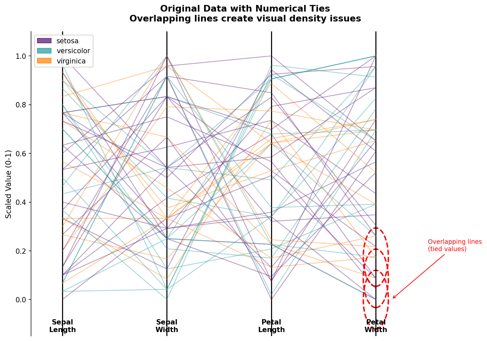{#fig-original-ties width=85%}

### Notation

Let $\mathcal{D}$ be a dataset with $n$ observations and $p$ variables displayed on parallel axes $X_1, X_2, \ldots, X_p$. 
All values are taken to be observed: an observation with a missing value on any displayed axis is excluded before plotting, as in the complete-case figures of this proposal, and the display of missing values in tie-broken plots lies outside the scope of this dissertation.

| Symbol | Definition |
|--------|------------|
| $x_{ij}$ | Raw value of observation $i$ on variable $j$ |
| $y_{ij}$ | Scaled value (normalized to $[0,1]$) |
| $\tilde{y}_{ij}$ | Adjusted value after tie-breaking |
| $T_j(v)$ | Set of observations tied at value $v$ on axis $j$ |
| $k$ | Number of tied observations: $k = |T_j(v)|$ |
| $r_j$ | Resolution of variable $j$ in data units: the grid on which its values are recorded |
| $\delta_j$ | Resolution of axis $j$: $r_j$ expressed in scaled axis units |

: Core notation {#tbl-notation}

### Scaling

Variables are normalized to $[0,1]$ using min-max scaling:

$$
y_{ij} = \frac{x_{ij} - \min(X_j)}{\max(X_j) - \min(X_j)}
$$ {#eq-scaling}


### The Tie-Breaking Algorithm

#### Step 1: Compute Axis Resolution

The band height on axis $j$ is set by the resolution of variable $j$: the grid on which its values are recorded, written $r_j$ in data units and $\delta_j$ once expressed on the scaled axis,

$$
\delta_j = \frac{r_j}{\max(X_j) - \min(X_j)}
$$ {#eq-resolution}

By default $r_j$ is estimated from the data as the smallest difference between adjacent distinct values, $r_j = \min\{|x_1 - x_2| : x_1 \neq x_2,\; x_1, x_2 \in X_j\}$. 
For a variable stored as a double this is the quantity `ggplot2::resolution()` computes, and the role is the same: `ggplot2` sets the default width of a bar or box from the resolution of the data and lets the user override it, and `tie_spread` does likewise through a `resolution` argument in data units; the default is built, and the argument remains to be built (@sec-defaults). 
For a variable stored as an integer the two differ: `resolution()` returns 1 whatever the gaps, and `tie_spread` still takes the smallest gap. 
The estimate is correct whenever the recorded values fill their grid, which is the common case for integer and fixed-decimal measurements; body mass in the penguins data is an integer column recorded on a 25 g grid, and the smallest observed gap is 25 g, where `resolution()` returns 1. 
It is not robust: a single pair of values recorded more finely than the rest, or a data-entry anomaly, shrinks every band on the axis. 
The override is the remedy, and a diagnostic, to be built with it, prompts it: when the smallest gap is far below the typical gap between adjacent values, the software names the axis and the pair of values responsible and suggests a resolution. 
A separate warning, already in `pcp_spread_ties()`, reports when $(1 - \sigma)\,\delta_j$ falls below the threshold `min_gap` (@sec-defaults). 
The resolution diagnostic will also report when an axis has no ties to spread.

A single resolution for the whole axis, rather than a spread range computed separately for each tied value, is what preserves both the density of observations at each value and the gaps between distinct values. 
A spread range set per value would risk collapsing visually meaningful gaps, destroying distance information in the display.

#### Step 2: Identify Ties

A value $v$ on axis $j$ is a tie if multiple observations share it:

$$
T_j(v) = \{i : y_{ij} = v\}, \quad |T_j(v)| > 1
$$ {#eq-ties}

#### Step 3: Compute Available Space {#sec-math-step3}

Each value $v$ is allocated a vertical interval on the axis bounded by the half-resolution distance to its neighbors:

$$
L(v) = v - \frac{\delta_j}{2}, \quad U(v) = v + \frac{\delta_j}{2}
$$ {#eq-bounds}

If $v$ lies within $\delta_j / 2$ of an axis endpoint, the allocation is clamped to the unit interval so that no band extends past the plotted axis:

- $L(v) = \max(0,\; v - \delta_j/2)$
- $U(v) = \min(1,\; v + \delta_j/2)$

Away from the boundary, the total allocation per value is the full resolution:

$$
S(v) = U(v) - L(v) = \delta_j
$$ {#eq-space}

This $S(v)$ is the numerical analog of the categorical $S_i$: it is the full per-unit allocation on the axis, including the margins reserved for inter-unit separation.
The clamped boundary case is the one place where the realized allocation $U(v) - L(v)$ is smaller than $\delta_j$; because the margins (@eq-margins) and spacing (@eq-spacing) are stated in terms of $S(v)$ rather than $\delta_j$, they contract with the realized allocation automatically and the clamped case requires no separate formula.

**Separation constraint.** 
Allocating the entire interval $[L(v), U(v)]$ to spread observations would, for evenly-spaced distinct values, produce regions that share endpoints with their neighbors and render as a single continuous column on the axis. 
This collapses the visual separation between distinct values and defeats the Gestalt grouping cue (see @fig-working-theory). 
We therefore introduce a separation parameter $\sigma \in (0, 1]$ (the `sigma` argument; default $\sigma = 0.9$, provisional) that reserves margins of equal width above and below the dot-placement region. 
The margins are defined as a fixed fraction of the realized allocation $S(v) = U(v) - L(v)$, so that a single formula covers both the generic and the clamped boundary case:

$$
S^+(v) = S^-(v) = \frac{(1 - \sigma) \cdot S(v)}{2}
$$ {#eq-margins}

Away from the axis boundary, $S(v) = \delta_j$ (@eq-space) and the margins reduce to $(1 - \sigma) \cdot \delta_j / 2$; in the clamped boundary case, $S(v) = U(v) - L(v) < \delta_j$ and the margins contract proportionally, so no special-case formula is needed. 
These margins are the numerical analog of the categorical $S_i^+$ and $S_i^-$: where the categorical margins are user-controlled via the `space` argument, the numerical margins are derived from $\sigma$. 
The dot-placement region, the actual vertical extent within which tied observations are spread, is the residual:

$$
S(v) - S^+(v) - S^-(v) = \sigma \cdot S(v)
$$ {#eq-inner}

which equals $\sigma \cdot \delta_j$ except at the clamped boundary, with bounds $[L(v) + S^-(v),\, U(v) - S^+(v)]$. 
The unencoded margins on either side preserve the perceptual gap between adjacent value bands.

#### Step 4: Compute Optimal Spacing

The inter-observation spacing is the dot-placement region (Equation @eq-inner) divided into $k - 1$ intervals:

$$
\boxed{\Delta(v) = \frac{S(v) - S^+(v) - S^-(v)}{k - 1} = \frac{\sigma \cdot S(v)}{k - 1}}
$$ {#eq-spacing}

which reduces to $\sigma \cdot \delta_j / (k - 1)$ everywhere except the clamped boundary case, where $S(v) < \delta_j$ shrinks the spacing proportionally.

This is the same formula used for categorical levels:

$$
d_i = \frac{S_i - S_i^+ - S_i^-}{n_i - 1}
$$

The two formulas are structurally identical; only what determines $S$ and $S^\pm$ differs, frequency and the user budget for categorical levels, the axis resolution $\delta_j$ and the separation parameter $\sigma$ for numerical values. 
The full correspondence is tabulated in @sec-unified.

**High-multiplicity limit.** 
@eq-spacing makes the algorithm's boundary behavior explicit: because the dot-placement region $\sigma \cdot \delta_j$ is fixed by the axis resolution and does not grow with the number of tied observations, the inter-observation gap $\Delta(v)$ is inversely proportional to $k - 1$. 
As tie multiplicity grows, $\Delta(v) \to 0$; for a fixed dot radius there is therefore a multiplicity $k^\star$ beyond which adjacent dots within a single band overlap, and the overplotting the spread was meant to resolve reappears inside the band. 
This limit is reached soonest exactly where ties are most common, small $\delta_j$ (finely or integer-valued axes) combined with large $k$, so it is a regime the method must confront rather than an unlikely corner. 
What fails here, and what does not, is specific. 
The three properties the construction is built to guarantee are unaffected: the allocation remains anchored to $\delta_j$, so the metric spacing of distinct values and the inter-band gaps are preserved regardless of $k$; the hierarchical ordering (Step 5) still holds, so no within-band crossings are introduced; and the tie region and its extent remain marked by the visual cue (@sec-visual-cues). 
What degrades is only the individual legibility of dots within a saturated band — a graceful failure, in that the band still signals that many observations share the value through a densely-filled region, and the count label states how many, rather than a silent collapse of the axis geometry. 
Because $\Delta(v)$ is known in closed form, the saturation point is predictable rather than a surprise: `pcp_spread_ties()` compares $\Delta(v)$ against a threshold, `min_spacing` (0.001 of the axis by default), and, when the band is over-full, emits a warning naming the affected values, the same class of diagnostic used when $\delta_j$ itself is too small for a perceptible inter-band gap (@sec-defaults). 
The threshold stands in for the diameter at which dots would touch, which depends on the rendered dot size and is not known at the wrangling step. 
On the 333 complete cases of the penguins data, body mass has $\delta_j = 25/3600 \approx 0.007$, so at $\sigma = 0.9$ the warning fires for any value shared by eight or more birds, and nine values are. 
The count label (@sec-visual-cues), on by default, carries the frequency the saturated band cannot, so saturation costs the reader dot legibility but not the count. 
Selecting the count-label threshold, and deciding whether saturated bands should also be drawn as filled regions, is informed by the sensitivity analysis (@sec-evaluation), which maps $\Delta(v)$ against the dot-contact threshold across the $(\sigma, \delta_j, k)$ grid; the final perceptually-validated choice is left to the calibration study specified as future work, and the mathematics simply guarantees that the transition is continuous and detectable rather than abrupt.

#### Step 5: Order Observations Within Each Band {#sec-math-step5}

This is the step that distinguishes the construction from single-axis spreading, and the step on which the crossing-minimization claim of @sec-sorting rests. 
To minimize line crossings, tied observations are sorted by their positions on the adjacent axis before spread positions are assigned. 
For axis $j$, let $A_j$ be the adjacent already-processed axis: the left neighbor under `from-left` processing, or the right neighbor under `from-right` processing.

For each observation $i \in T_j(v)$, the sorting key is:

$$
\kappa_i = \tilde{y}_{i,A_j}
$$ {#eq-sortkey}

Observations are ordered so that $\kappa_{i_1} \leq \kappa_{i_2} \leq \cdots \leq \kappa_{i_k}$.

One boundary case requires an explicit convention: the initial axis of each sweep has no already-processed neighbor, so @eq-sortkey is undefined there. 
Under `from-right`, processing begins at the rightmost axis $p$, for which no right neighbor exists; symmetrically, `from-left` begins at axis $1$, which has no left neighbor, and `from-both` begins at the center axis, whose seam handling is described alongside the processing modes above. 
In all three cases the convention is the same: ties on the initial axis are spread with $\kappa_i$ set to input order (equivalently, no sorting reference), which introduces no within-band crossings on that axis itself, the within-band positions are still assigned by @eq-assign, and leaves the between-axis crossings adjacent to it to be minimized when the next axis in the sweep is sorted against it. 
An initial axis ordered arbitrarily costs nothing that the sweep does not immediately recover: the neighbor processed second is sorted against the initial axis's realized positions, whatever they are, so the monotone rank-matching between the first pair of axes is intact. 
This is the same convention already stated for the `from-both` center axis, applied uniformly to whichever axis begins the sweep; under `from-both`, the `center_reference` argument replaces input order with the order on a nominated neighbor.

This ordering is the step that resolves the visual "knots" illustrated in @fig-working-theory. 
Spreading alone distributes tied points across the interval $[L(v),\, U(v)]$, but without a consistent rank-matching to the neighbor axis, lines departing the band will cross inside it. 
Sorting by $\kappa_i$ before assigning positions in @eq-assign creates a monotone mapping: the observation placed at rank $m$ in the tie band is exactly the observation ranked $m$-th on the neighbor axis. 
Under `from-right` processing, this means the lowest position in the band connects to the lowest position on the right axis, eliminating within-band crossings entirely. 
Any crossings that remain after this step are necessary crossings induced by the data structure itself.

**Key insight**: This requires sequential axis processing, the adjusted positions from previously processed axes inform the ordering on the current axis.

#### Step 6: Assign Positions

Given ordered observations $(i_1, i_2, \ldots, i_k)$, positions are assigned within the dot-placement region, the interior of the allocation $[L(v), U(v)]$ after the margins $S^-(v)$ and $S^+(v)$ are reserved:

$$
\tilde{y}_{i_m, j} = L(v) + S^-(v) + (m - 1) \cdot \Delta(v), \quad m = 1, 2, \ldots, k
$$ {#eq-assign}

#### Properties of the Construction {#sec-math-props}

Two guarantees follow from Steps 1–6. 
Both are argued informally elsewhere in this document; they are stated here as properties so that what the method promises is exact. 
Throughout, $\delta_j$ is the resolution of @eq-resolution, and the standing hypothesis is that no two distinct values on axis $j$ are closer than the resolution, $|v - v'| \geq \delta_j$ for all distinct $v, v' \in Y_j$. 
Under the default of Step 1 this holds with equality for the closest pair; a user override larger than the smallest gap violates it, which is the condition the resolution diagnostic reports.

::: {#prp-metric .proposition}
## Metric preservation
Let $v < v'$ be distinct values on axis $j$, and let $\tilde{y}_{ij}$ denote adjusted positions after Step 6, with untied observations left at their values. Then

(i) every adjusted position of an observation at $v$ lies strictly below every adjusted position of an observation at $v'$, so the order of values on the axis is preserved;
(ii) every observation is displaced by at most half the resolution, $|\tilde{y}_{ij} - y_{ij}| \leq \delta_j / 2$, and by at most $\sigma \delta_j / 2$ away from the axis boundary;
(iii) away from the axis boundary, the band at $v$ is centered at $v$, so the distances between band centers equal the distances between the values exactly;
(iv) the gap between the bands at $v$ and $v'$ is at least $(1 - \sigma)\,\bigl(S(v) + S(v')\bigr)/2$: that is $(1 - \sigma)\,\delta_j$ when neither band is clamped at an axis end, $\tfrac{3}{4}(1 - \sigma)\,\delta_j$ when one is, and $\tfrac{1}{2}(1 - \sigma)\,\delta_j$ when both are; for adjacent values the last case arises only on an axis with two distinct values.
:::

<!-- ::: {.proof} -->
<!-- By Steps 3 and 4, positions in the band at $v$ lie in $[L(v) + S^-(v),\, U(v) - S^+(v)]$, which is contained in $[L(v), U(v)] \subseteq [v - \delta_j/2,\, v + \delta_j/2]$; clamping at the axis ends only shrinks the interval.  -->
<!-- This gives (ii), with the sharper bound $\sigma \delta_j / 2$ when the interval is not clamped, since the margins then equal $(1 - \sigma)\delta_j/2$ on each side.  -->
<!-- When the interval is not clamped, $L(v) = v - \delta_j/2$ and $U(v) = v + \delta_j/2$, and the margins are equal, so the band is symmetric about $v$; this is (iii).  -->
<!-- For (i) and (iv), the top of the band at $v$ is $U(v) - S^+(v)$ and the bottom of the band at $v'$ is $L(v') + S^-(v')$, so the gap between them is $L(v') - U(v) + S^+(v) + S^-(v')$.  -->
<!-- By the standing hypothesis $v' - v \geq \delta_j$, so $L(v') \geq v' - \delta_j/2 \geq v + \delta_j/2 \geq U(v)$ whether or not either interval is clamped, and the gap is at least $S^+(v) + S^-(v') = (1 - \sigma)\,\bigl(S(v) + S(v')\bigr)/2$, which is positive for $\sigma < 1$.  -->
<!-- An unclamped allocation has $S = \delta_j$ and a clamped one has $\delta_j/2 \leq S < \delta_j$, since the margins contract with the allocation (@eq-margins); this gives the three cases.  -->
<!-- Bands at adjacent values can both be clamped only if $v < \delta_j/2$ and $v' > 1 - \delta_j/2$ with no value between them; then $v = 0$ and $v' = 1$ are the only values on the axis, and $\delta_j = 1$.  -->
<!-- An untied observation sits at its value and satisfies all four statements trivially. -->
<!-- ::: -->

::: {#prp-crossings .proposition}
## No within-band crossings
Let axis $j$ be processed with reference neighbor $A_j$, already processed, and let $i, i'$ be two observations tied at the same value $v$ on axis $j$. Then the segments joining their positions on $A_j$ to their positions on $j$ do not cross: $(\tilde{y}_{i,A_j} - \tilde{y}_{i',A_j})(\tilde{y}_{ij} - \tilde{y}_{i'j}) > 0$.
:::

<!-- ::: {.proof} -->
<!-- After an axis is processed, its adjusted positions are pairwise distinct: within a band, consecutive positions differ by $\Delta(v) > 0$ (@eq-spacing, with $k \geq 2$); bands at distinct values are disjoint by @prp-metric (i); and untied observations sit at distinct values.  -->
<!-- Hence the sorting keys $\kappa_i = \tilde{y}_{i,A_j}$ of @eq-sortkey are distinct for distinct observations, and Step 5 orders $T_j(v)$ so that $\kappa_{i_1} < \kappa_{i_2} < \cdots < \kappa_{i_k}$.  -->
<!-- Step 6 assigns $\tilde{y}_{i_m,j} = L(v) + S^-(v) + (m-1)\Delta(v)$, which is strictly increasing in $m$.  -->
<!-- The two orderings agree, so the product in the statement is positive. -->
<!-- ::: -->

The second proposition concerns one band and one pair of adjacent axes. 
It says nothing about crossings between observations in different bands, or between an observation in a band and an untied one; those are determined by the data and the axis order, and @sec-sorting explains why the one-pass sweep does not minimize them globally. 
The initial axis of a sweep has no reference neighbor and takes its within-band order from the input; @prp-crossings then applies to the next axis, which is sorted against it.

### Unified Framework {#sec-unified}

The algorithm treats numerical values and categorical levels identically at the formula level: the same spacing equation governs both, and the same five quantities ($S$, $S^+$, $S^-$, $n$, and the inter-observation spacing) are present in both cases. 
What differs is how each quantity is determined.

| | Categorical | Numerical |
|---|---|---|
| Total allocation | $S_i$ (set by frequency proportion under user budget) | $S(v) = \delta_j$ (set by axis resolution; constant across values) |
| Margin above | $S_i^+$ (user-controlled via `space`) | $S^+(v) = (1-\sigma) \cdot S(v) / 2$ (derived from $\sigma$) |
| Margin below | $S_i^-$ (user-controlled via `space`) | $S^-(v) = (1-\sigma) \cdot S(v) / 2$ (derived from $\sigma$) |
| Count | $n_i$ (level frequency) | $n(v) = k$ (tie multiplicity) |
| Spacing | $d_i = (S_i - S_i^+ - S_i^-) / (n_i - 1)$ | $\Delta(v) = (S(v) - S^+(v) - S^-(v)) / (n(v) - 1)$ |

: Unified spacing framework: identical formula structure, type-specific parameter semantics. {#tbl-unified}

The shared formula is **spacing = (allocation − margins) / (n − 1)**. 
The innovation in extending the categorical procedure to numerical variables lies entirely in the right-hand column: anchoring the per-value allocation to the axis resolution and deriving the margins from a single perceptual parameter $\sigma$, rather than from frequencies and user input.

## Visual Results

After applying the tie-breaking algorithm, observations that previously overlapped become visually distinguishable (@fig-uniform-spacing). 
Tie regions can additionally be annotated with boxes showing the original value and the spread region (@fig-annotated), and the construction of the boxes that `pcp_tie_boxes()` returns is illustrated in @fig-tie-box. 
The figures in this section are drawn with a self-contained reference implementation of Steps 1–6, so that the document compiles against the published package; `pcp_spread_ties()` implements the same steps, and the package vignette shows its output on `iris`, the flea beetle data, and the penguins.

```{r}
#| label: fig-uniform-spacing
#| echo: false
#| fig-pos: "H"
#| fig-width: 9
#| fig-height: 5
#| fig-cap: "The `tie_spread` algorithm applied to four measurement variables of the Palmer
#|   penguins data (14 complete cases per species, $n = 42$), processed `from-left` with
#|   $\\sigma = 0.9$. Left: every value shared by two or more observations receives a gray
#|   band of height $\\sigma \\cdot \\delta_j$ on the dot-placement region, identical for
#|   every tied value on an axis regardless of multiplicity. Because the measurements are
#|   recorded at a resolution that is fine relative to their range, the scaled resolutions
#|   are small ($\\delta_j = 0.005$, $0.013$, $0.019$ and $0.009$ for the four axes) and the
#|   bands are correspondingly thin; this is the small-$\\delta_j$ regime discussed under
#|   the high-multiplicity limit, and at $\\sigma = 0.9$ the inter-band gap
#|   $(1-\\sigma)\\,\\delta_j$ falls below the default `min_gap` of 0.005 on all four axes, so
#|   the gap warning of @sec-defaults fires on each of them, as it does for `iris` in the
#|   package vignette. Right: a magnified window on the flipper-length axis around the
#|   value with the largest multiplicity. Within each band the tied observations are ordered by their
#|   adjusted positions on the bill-depth axis (the left neighbor), so the polylines
#|   entering the band do not cross inside it, and the gaps $S^\\pm(v)$ between adjacent
#|   bands remain visible."

library(patchwork)

axes        <- c("bill_length_mm", "bill_depth_mm", "flipper_length_mm", "body_mass_g")
axis_labels <- c("Bill length\n(mm)", "Bill depth\n(mm)", "Flipper length\n(mm)", "Body mass\n(g)")

# ── 1. Data: 14 complete cases per species ────────────────────────────────────
peng <- penguins %>%
  drop_na(all_of(axes)) %>%
  group_by(species) %>% slice_head(n = 14) %>% ungroup() %>%
  mutate(id = row_number())

# ── 2. tie_spread(): Steps 1–6 of the mathematical framework ─────────────────
tie_spread <- function(data, vars, id, sigma = 0.9,
                       method = c("from-left", "from-right"),
                       resolution = NULL) {                        # r_j in data units; NULL = estimate
  method <- match.arg(method)
  p <- length(vars); n <- nrow(data)
  s01 <- function(x) (x - min(x)) / (max(x) - min(x))
  Y     <- sapply(data[vars], s01)                                  # Eq. 1
  Y_adj <- Y
  rng   <- sapply(data[vars], function(x) diff(range(x)))
  r     <- if (is.null(resolution))                                 # Step 1: smallest gap between distinct values
    sapply(data[vars], function(x) min(diff(sort(unique(x))))) else resolution
  delta <- r / rng                                                  # Eq. 2
  sweep <- if (method == "from-left") seq_len(p) else rev(seq_len(p))
  bands <- list()
  for (step in seq_along(sweep)) {
    j   <- sweep[step]
    A_j <- if (step == 1) NA else sweep[step - 1]                   # already-processed neighbor
    x   <- data[[vars[j]]]
    for (v_raw in unique(x[duplicated(x)])) {                       # Step 2, Eq. 3: tied values
      T_v <- which(x == v_raw); k <- length(T_v)
      v   <- Y[T_v[1], j]
      L <- max(0, v - delta[j] / 2); U <- min(1, v + delta[j] / 2)  # Step 3, Eq. 4 (clamped)
      S <- U - L                                                    # Eq. 5
      m <- (1 - sigma) * S / 2                                      # Eq. 6: S^+(v) = S^-(v)
      Delta <- sigma * S / (k - 1)                                  # Step 4, Eq. 8
      kappa <- if (is.na(A_j)) seq_len(k) else Y_adj[T_v, A_j]      # Step 5, Eq. 9
      T_v <- T_v[order(kappa)]
      Y_adj[T_v, j] <- L + m + (seq_len(k) - 1) * Delta             # Step 6, Eq. 10
      bands[[length(bands) + 1]] <- tibble(
        axis = j, value = v_raw, k = k, lo = L + m, hi = U - m)     # dot-placement region
    }
  }
  lines <- tibble(id   = rep(data[[id]], times = p),
                  axis = rep(seq_len(p), each = n),
                  y    = as.vector(Y), y_adj = as.vector(Y_adj))
  list(lines = lines, bands = bind_rows(bands), delta = delta)
}

res   <- tie_spread(peng, axes, id = "id", sigma = 0.9, method = "from-left")
lines <- res$lines %>% left_join(select(peng, id, species), by = "id")
bands <- res$bands

# ── 3. Shared layers ──────────────────────────────────────────────────────────
species_cols <- c(Adelie = "#E69F00", Chinstrap = "#CC79A7", Gentoo = "#009E73")
axis_df <- tibble(axis = seq_along(axes))
half_w  <- 0.05                                   # half-width of the tie boxes (x units)

pcp_layers <- function() {
  list(
    geom_segment(data = axis_df, aes(x = axis, xend = axis, y = 0, yend = 1),
                 colour = "grey35", linewidth = 0.4),
    geom_rect(data = bands,
              aes(xmin = axis - half_w, xmax = axis + half_w, ymin = lo, ymax = hi),
              fill = "grey60", alpha = 0.6, colour = NA),
    geom_line(data = lines, aes(x = axis, y = y_adj, group = id, colour = species),
              linewidth = 0.4, alpha = 0.9),
    scale_colour_manual(values = species_cols, name = NULL),
    labs(x = NULL, y = "scaled value"),
    theme_bw(base_size = 11),
    theme(panel.grid = element_blank(), legend.position = "top")
  )
}

# ── 4. Left panel: the full plot ──────────────────────────────────────────────
p_full <- ggplot() + pcp_layers() +
  scale_x_continuous(breaks = seq_along(axes), labels = axis_labels,
                     expand = expansion(add = 0.35)) +
  scale_y_continuous(breaks = seq(0, 1, 0.25))

# ── 5. Right panel: magnified window on the flipper-length axis ──────────────
zoom_axis <- 3
zb   <- bands %>% filter(axis == zoom_axis) %>% slice_max(k, n = 1, with_ties = FALSE)
h    <- zb$hi - zb$lo                              # = sigma * delta_j on this axis
ylim <- c(zb$lo - 3 * h, zb$hi + 3 * h)

for (i in 1:5) {                                  # grow the window until it holds whole bands only
  win  <- bands %>% filter(axis == zoom_axis, hi >= ylim[1], lo <= ylim[2])
  new_ylim <- c(min(win$lo) - h, max(win$hi) + h)
  if (isTRUE(all.equal(new_ylim, ylim))) break
  ylim <- new_ylim
}

p_zoom <- ggplot() + pcp_layers() +
  geom_point(data = filter(lines, axis == zoom_axis),
             aes(x = axis, y = y_adj, colour = species), size = 1.4) +
  coord_cartesian(xlim = c(zoom_axis - 0.3, zoom_axis + 0.3), ylim = ylim, expand = FALSE) +
  scale_x_continuous(breaks = zoom_axis, labels = axis_labels[zoom_axis]) +
  scale_y_continuous(breaks = (win$lo + win$hi) / 2,
                     labels = paste0(win$value, " mm  (k = ", win$k, ")")) +
  labs(y = NULL) +
  theme(legend.position = "none")

p_full + p_zoom + plot_layout(widths = c(2.4, 1))
```


```{r}
#| label: fig-annotated
#| echo: false
#| fig-pos: "H"
#| fig-width: 9
#| fig-height: 5
#| fig-cap: "The same layout as @fig-uniform-spacing with each tie band labeled by the original
#|   tied value, the numerical analog of `geom_pcp_labels`. Labels are placed at the band
#|   centre, which is the true value $v$, so the displacement inside the band can be read as
#|   artifact and the value recovered exactly. Where bands on an axis are closer together
#|   than a label's height, later labels are suppressed rather than overprinted; this is
#|   the clutter threshold below which @sec-defaults proposes suppressing boxes."

p_full +
  geom_text(data = arrange(bands, desc(k)), 
            aes(x = axis + half_w + 0.03, y = (lo + hi) / 2, label = value),
            hjust = 0, size = 2.4, colour = "grey25", check_overlap = TRUE)
```

{#fig-tie-box width=90% fig-pos="H"}

@fig-uniform-spacing and @fig-annotated show the method working; they do not show how it compares with what a user would otherwise do. 
@fig-flea-coercion makes that comparison on the flea beetle data [@lubischew1962], 74 beetles of three species measured on six integer-valued variables, restricted to the four measurements in the regime `tie_spread` is built for (@sec-novelty): `tars1`, `tars2`, `aede1`, and `aede3` take 46, 33, 34, and 33 distinct values, and on each of them between 48 and 62 of the 74 beetles share their value with at least one other beetle, in groups of up to seven. 
A user facing these axes has four options, and the figure draws all four. 
Leaving the values exact collapses each tie to a point. 
Jitter separates the lines, at random and without regard to the neighboring axis, so lines cross inside the jittered region and the displacement is unrelated to the data. 
Coercion, the treatment `pcp_arrange` offers, turns each axis into 33 to 46 thin, equally spaced boxes and discards the metric scale: the two beetles at the largest gaps in the data, 19 units on `tars1` and 11 on `aede3`, sit one level-gap from their neighbors as every other beetle does. 
`tie_spread` separates the tied lines, orders them by the neighboring axis, bounds the displacement by the resolution, marks the region, and keeps the axis metric, so the two beetles stand apart as they do under exact values and jitter. 
The figure shows what is drawn; whether viewers trace observations more reliably through spread ties than through exact or jittered ones is the question of the viewer study (@sec-viewer-study).

```{r}
#| label: fig-flea-coercion
#| echo: false
#| fig-pos: "H"
#| fig-width: 9
#| fig-height: 8
#| fig-cap: "The four treatments a user can apply to the flea beetle data (74 beetles,
#|   three species) on four integer-valued measurements with 33 to 46 distinct values
#|   each. Top left: exact values, where tied observations coincide. Top right: jitter at
#|   `ggplot2`'s default, a uniform offset within 40% of the axis resolution, applied
#|   to every observation. Bottom left: each variable coerced to a factor and arranged with
#|   `pcp_arrange`; every distinct value becomes a level, box height encodes frequency, and
#|   every gap is drawn the same, so each axis becomes a ladder of thin boxes. Bottom
#|   right: `tie_spread` ($\\sigma = 0.9$, `from-left`), with gray bands at the tied
#|   values. The black lines are the beetles at the two largest gaps in the data, 19 units
#|   on `tars1` and 11 on `aede3`; the three numeric treatments show both as outlying, and
#|   coercion places each one level-gap from its neighbor. At this scale the three numeric
#|   treatments share one geometry; they differ inside the ties, in whether lines there are
#|   separated, ordered, bounded, and marked, which is what the tracing task of
#|   @sec-viewer-study tests. The two few-valued measurements, `head` (13 values) and
#|   `aede2` (9), are omitted here; `head` serves as the boundary case in that study."

flea_axes <- c("tars1", "tars2", "aede1", "aede3")
flea_df   <- GGally::flea %>% mutate(id = row_number())
flea_cols <- c("#E69F00", "#56B4E9", "#009E73")
names(flea_cols) <- levels(flea_df$species)
# the two isolated beetles: 242 on tars1 (19 above the next value), 55 on aede3 (11 below the next)
out_ids <- flea_df$id[flea_df$tars1 == 242 | flea_df$aede3 == 55]

flea_theme <- theme_bw(base_size = 10) +
  theme(panel.grid = element_blank(), axis.text.y = element_blank(),
        axis.ticks.y = element_blank(), legend.position = "none")

# ── Panels on the numeric scale: exact values, default jitter, tie_spread ─────
res_f  <- tie_spread(flea_df, flea_axes, id = "id", sigma = 0.9, method = "from-left")
long_f <- res_f$lines %>% left_join(select(flea_df, id, species), by = "id")
set.seed(2027)
long_f <- long_f %>%
  group_by(axis) %>%                                                  # ggplot2's position_jitter default:
  mutate(y_jit = y + runif(n(), -0.4, 0.4) * res_f$delta[axis]) %>%  # uniform within 40% of the resolution
  ungroup()

numeric_panel <- function(ycol, title, bands = NULL) {
  p <- ggplot() +
    geom_segment(data = tibble(axis = seq_along(flea_axes)),
                 aes(x = axis, xend = axis, y = 0, yend = 1), colour = "grey35", linewidth = 0.4)
  if (!is.null(bands))
    p <- p + geom_rect(data = bands, aes(xmin = axis - 0.05, xmax = axis + 0.05, ymin = lo, ymax = hi),
                       fill = "grey60", alpha = 0.6, colour = NA)
  p +
    geom_line(data = long_f, aes(x = axis, y = .data[[ycol]], group = id, colour = species),
              linewidth = 0.35, alpha = 0.8) +
    geom_line(data = filter(long_f, id %in% out_ids), aes(x = axis, y = .data[[ycol]], group = id),
              colour = "black", linewidth = 1) +
    scale_colour_manual(values = flea_cols) +
    scale_x_continuous(breaks = seq_along(flea_axes), labels = flea_axes) +
    labs(title = title, x = NULL, y = NULL) + flea_theme
}
p_exact  <- numeric_panel("y",     "Exact values (no tie-breaking)")
p_jitter <- numeric_panel("y_jit", "Jitter (ggplot2 default, 40% of resolution)")
p_ts     <- numeric_panel("y_adj", "tie_spread (variables stay numeric)", res_f$bands)

# ── Factor coercion, the route pcp_arrange offers ─────────────────────────────
pcp_fac <- flea_df %>%
  mutate(across(all_of(flea_axes), factor)) %>%
  pcp_select(all_of(flea_axes)) %>%
  pcp_scale(method = "uniminmax") %>%
  pcp_arrange(method = "from-left")
p_fac <- ggplot(pcp_fac, aes_pcp()) +
  geom_pcp_axes() +
  geom_pcp_boxes(boxwidth = 0.1, fill = "grey85", colour = "grey60", alpha = 0.5) +
  geom_pcp(aes(colour = species), linewidth = 0.35, alpha = 0.8) +
  geom_pcp(data = filter(pcp_fac, id %in% out_ids), colour = "black", linewidth = 1) +
  scale_colour_manual(values = flea_cols, name = NULL) +
  scale_x_discrete(labels = flea_axes) +
  labs(title = "Factor coercion (pcp_arrange)", x = NULL, y = NULL) + flea_theme

(p_exact + p_jitter) / (p_fac + p_ts)

```


## Algorithm Summary

**Algorithm: Unified Tie-Breaking**

Input: Data $D$, variables $X_1...X_p$, method $\in$ {from-left, from-right, from-both}, separation $\sigma \in (0, 1]$

Output: Adjusted positions $\tilde{y}_{ij}$

1. Scale all variables to $[0,1]$
2. For each axis $j$, compute resolution: $\delta_j = \min |y_1 - y_2|$ for distinct $y_1, y_2 \in Y_j$
3. Set processing order based on method:

- from-left: process axes $1, 2,  \ldots ,p$; reference left neighbor (axis $1$, processed first, has no left neighbor — see step 4.iv)
- from-right: process axes $p, p-1,  \ldots ,1$; reference right neighbor (axis $p$, processed first, has no right neighbor — see step 4.iv)
- from-both: process outward from center axis; reference the previously processed neighbor nearer the center (the center axis, processed first, has no reference — see step 4.iv)

4. For each axis $j$ in processing order:
     a. Identify tied values: $V = \{v : |T_j(v)| > 1\}$
     b. For each $v \in V$:
          i.   Compute clamped outer bounds: $L(v) = \max(0,\; v - \delta_j/2)$, $U(v) = \min(1,\; v + \delta_j/2)$
          ii.  Set realized allocation: $S(v) = U(v) - L(v)$ ($= \delta_j$ away from the axis boundary)
          iii. Set margins: $S^+(v) = S^-(v) = (1 - \sigma) \cdot S(v) / 2$
          iv.  Order $T_j(v)$ by $\kappa_i = \tilde{y}_{i, A_j}$ (positions on the already-processed adjacent axis $A_j$; right neighbor under `from-right`, left neighbor under `from-left`). If $j$ is the initial axis of the sweep, $A_j$ does not exist: set $\kappa_i$ to input order (no sorting reference); under from-both, a nominated neighbor of the center may supply the order instead
          v.   Compute spacing: $\Delta(v) = (S(v) - S^+(v) - S^-(v)) / (k - 1)$
          vi.  Assign positions: $\tilde{y}_{i_m, j} = L(v) + S^-(v) + (m - 1) \cdot \Delta(v)$ for $m = 1, \ldots, k$
5. Return adjusted data

In `ggpcp` the algorithm is `pcp_spread_ties()`, applied after `pcp_arrange()` and restricted to selected axes by `vars`; `pcp_arrange_unified()` runs the two steps in one call.

<!--
**Computational complexity.** 
Because line overplotting is chiefly a large-$n$ problem, the algorithm's scalability is worth stating explicitly. 
For $n$ observations and $p$ axes, the dominant cost per axis is sorting: computing the resolution $\delta_j$ requires the sorted unique values ($O(n \log n)$), grouping ties is a single pass after sorting ($O(n)$), and ordering each tie band by the neighbor key $\kappa_i$ sorts disjoint subsets whose sizes total at most $n$, hence $O(n \log n)$ across all bands on the axis; position assignment (steps i–vi) is constant work per observation. 
The sweep visits each axis exactly once and never revisits, so the total runtime is $O(p \cdot n \log n)$ with $O(np)$ memory, the same order as sorting the data once per axis, and the same complexity class as the categorical procedure already in `ggpcp`, which the implementation shares its vectorized `dplyr` grouping machinery with. 
There is no combinatorial search anywhere in the pipeline (the greedy sweep of @sec-sorting is what purchases this): runtime grows near-linearly in practice, and datasets in the $10^5$–$10^6$ observation range remain tractable, at which point rendering the polylines, not computing their positions, is the binding constraint.
-->
# References
