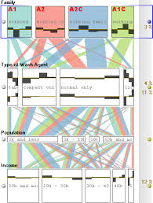
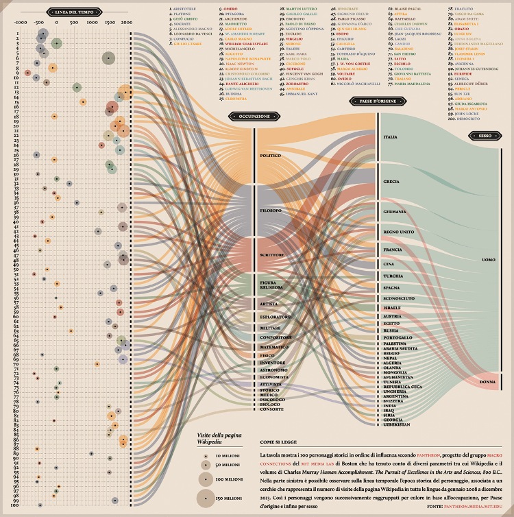
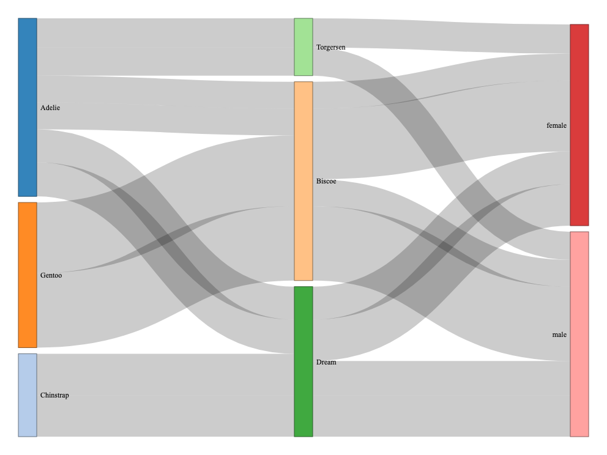
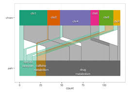
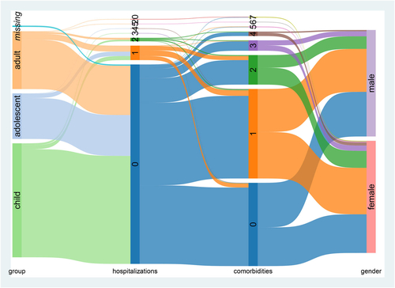
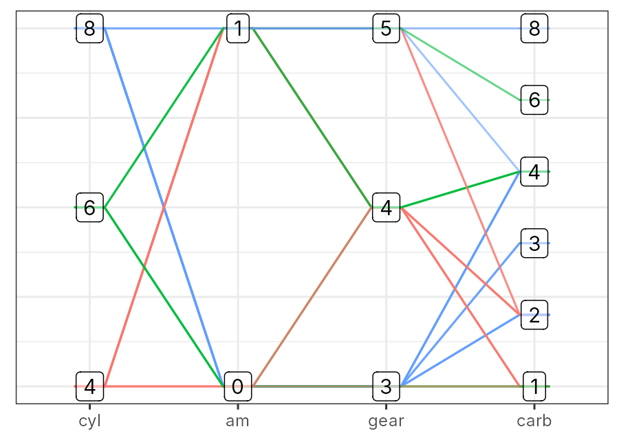
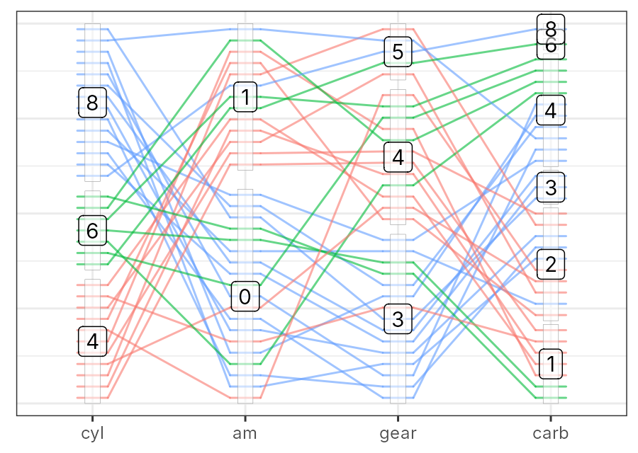
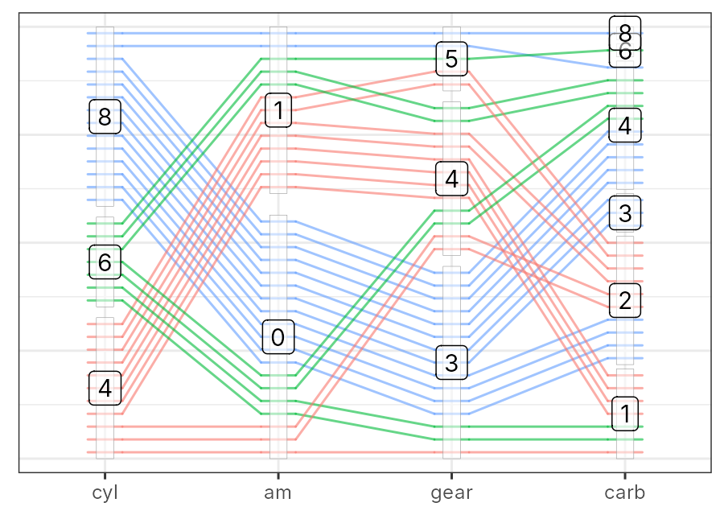
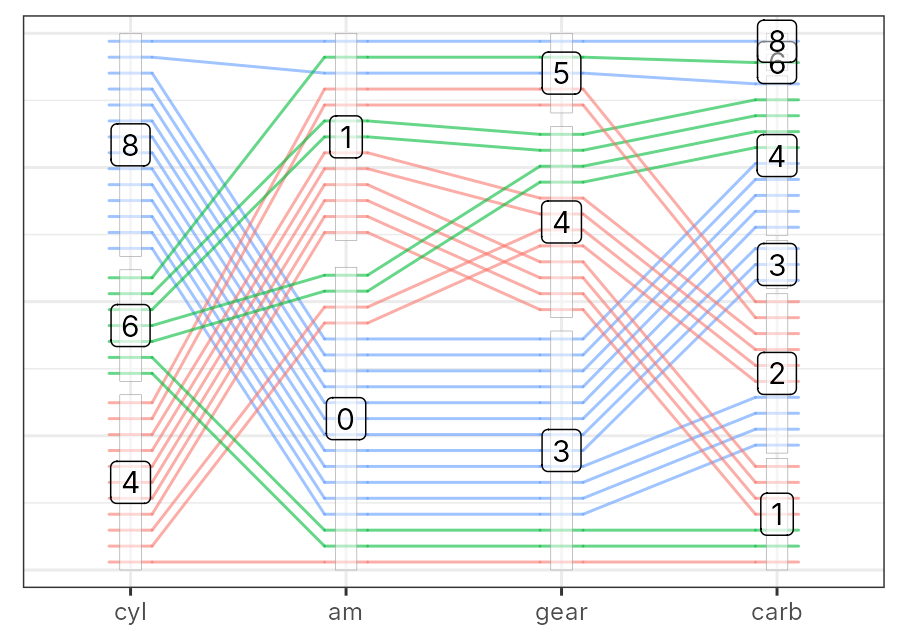

# Literature Review

Every method reviewed in this chapter has already met the tie problem, and each one has settled it by giving something up.
Alpha blending and density rendering keep the axis honest and lose the individual line; jitter and beeswarms keep the line and lose its exact value; Sankey, parallel sets, and hammock plots keep the counts and lose the observations altogether; the categorical machinery of `ggpcp` keeps both, but only on an axis that has no scale to protect.
No one has yet kept the line, the count, and the scale at once on an axis that stays numeric.
The purpose of this chapter is to show, tradition by tradition, what each of them paid and why, because the method in Chapter 3 is built from the parts that survived those trades.

Parallel coordinate plots represent each observation as a polyline across a set of parallel axes.
When several observations share a value on an axis, their polylines pass through the same point, and two kinds of information are lost at once: the identity of each observation through the shared point, and the number of observations that share it.
It is organized to follow the structure of the research proposal, so that each thread reviewed here feeds a specific component of the method (Chapter 3), the computational evaluation and viewer study (Chapter 4), or the perceptual work left for the future (Chapter 5).

## Introduction and Chapter Overview {#sec-overview}

The dissertation extends generalized parallel coordinate plots (GPCPs), as implemented in the `ggpcp` package [@vanderplas2023], with a treatment of ties on axes that remain numeric.
The existing package resolves ties on categorical axes by allocating each level a box proportional to its marginal frequency and spreading the tied observations evenly within it, ordered hierarchically so that lines do not cross inside the box.
Ties on numeric axes receive no such treatment: observations sharing a value are drawn at the same point.
The proposed `tie_spread` construction closes this gap while keeping the axis numeric.

An earlier draft of this chapter organized the review around the grammar of graphics as a theory of visualization.
That organization emphasized why a tie-breaking transformation is admissible within the grammar, which is a settled point, and left the more consequential questions — how much to spread, in what order, and how to mark the result — without a body of literature to draw on.
The present chapter reverses the emphasis.
It is organized around the problem and the five areas of prior work that constrain its solution: overplotting and density (@sec-overplotting), categorical extensions of parallel axes (@sec-categorical), perceptual bounds on vertical displacement (@sec-perception), axis and category ordering (@sec-ordering), and computational quality metrics (@sec-metrics).
The grammar of graphics is retained as the framework within which the method is implemented (@sec-grammar) rather than as the organizing principle.
@sec-pcp first establishes the history of parallel coordinate plots and the status of ties within it, and @sec-gap closes by stating the research gap, the three research questions, and the contributions the dissertation claims.

## Parallel Coordinate Plots and the Treatment of Ties {#sec-pcp}

### Origins and development {#sec-origins}

The parallel-axis construction predates its use for data.
@docagne1885 introduced parallel coordinates as a method of graphical computation, in which the point–line duality between Cartesian and parallel coordinates was used to solve geometric problems rather than to display observations.
The technique was revived for data analysis by Inselberg [-@inselberg1985; -@inselberg2009], who developed its geometry systematically: a point in $p$-dimensional space becomes a polyline across $p$ parallel axes, a line in the original space becomes a point between adjacent axes, and higher-order structures (hyperplanes, convex sets) acquire characteristic visual signatures.
Wegman [-@wegman1990] brought the display into statistical practice, emphasizing its use for detecting clusters and outliers, working out the interpretation of pairwise structure between adjacent axes, and treating the problem of axis permutation so that every pair of variables is adjacent somewhere in a small set of plots.
Wegman and Luo [-@wegman1997] later combined the display with the grand tour and with saturation-based density rendering to handle data sets of several hundred thousand observations; both developments recur below, the former in the discussion of axis ordering (@sec-ordering) and the latter in the discussion of overplotting (@sec-overplotting).

### Analytical properties {#sec-properties}

Three properties account for the continued use of the display.
First, all $p$ variables are shown at once without projection, so no dimension is discarded; a scatterplot matrix shows the same pairwise information but requires $\binom{p}{2}$ panels, whereas a parallel coordinate plot requires one.
Second, bivariate structure between adjacent axes is legible directly: by Inselberg's duality, strongly positively associated adjacent variables produce near-parallel segments, and strongly negatively associated ones produce segments that cross near a single point between the axes.
Third, because each observation is a single connected polyline, the display supports following an individual case through all variables, which is the operation that makes higher-order patterns — cluster membership, outlying combinations, conditional structure — visible at all.
The third property is the one this dissertation is concerned with, because it is the one that ties destroy.

These properties come with a known dependence on axis order [@wegman1990; @ankerst1998; @heinrich2013], which is taken up in @sec-ordering, and on scaling, since each axis is normalized to a common range before plotting.

### Ties as an unaddressed aspect of the classical display {#sec-ties}

A tie occurs when two or more observations take the same value on an axis.
Following the notation used in Chapter 3, let $y_{ij}$ denote the scaled value of observation $i$ on axis $j$; the set of observations tied at value $v$ on axis $j$ is $T_j(v) = \{i : y_{ij} = v\}$, and the tie multiplicity is $k = |T_j(v)|$.
The resolution of axis $j$, $\delta_j$, is the smallest distance between two distinct values on that axis.
Ties arise in continuous data whenever measurement resolution is coarse relative to sample size, and they are structural rather than incidental for integer-valued, count, and rounded variables.
The Palmer penguins measurements, recorded to the nearest millimetre or gram, contain ties at multiplicities up to four in a subset of 42 cases, and many applied data sets are far coarser.

At a tie, the polylines of all $k$ observations pass through the same point, and two consequences follow.
The observation's identity is not carried across the axis: a viewer following a line into the tie cannot tell which of the $k$ departing lines continues it, except by color, which is unreliable at small hue differences and unavailable under color vision deficiency (@sec-color).
And the marginal density at $v$ is not visible: $k$ coincident lines occupy the same pixels as one.
The original treatments of the display did not address either consequence [@inselberg1985; @wegman1990], and the survey of @heinrich2013 discusses overplotting as a density problem rather than as a tie problem.
VanderPlas et al. [-@vanderplas2023] identify ties as the principal obstacle to following an observation from axis to axis, and observe that without that ability the display reverts to a sequence of bivariate views.

In the terms used in the earlier draft of this chapter, a tie makes the mapping from data to position non-injective: distinct observations map to the same visual position, and the mapping cannot be inverted by inspection.
That framing is retained (Definition 2.1) because it states what a tie-breaking transformation must restore, but it does not by itself say how the restoration should be done.
The remainder of the chapter reviews the literature that constrains the answer.

**Definition 2.1 (Tie and visual ambiguity).**
On axis $j$, value $v$ is tied if $|T_j(v)| > 1$.
A position mapping $M_j : \{1, \dots, n\} \to [0, 1]$ is visually ambiguous at $v$ if $M_j(i) = M_j(i')$ for some $i \neq i'$ in $T_j(v)$.
A tie-breaking transformation replaces $M_j$ with a mapping $\tilde{M}_j$ that is injective on $T_j(v)$ while bounding $|\tilde{M}_j(i) - v|$ for every $i \in T_j(v)$.

## Overplotting and Density {#sec-overplotting}

Ties are the limiting case of overplotting: $k$ lines occupy zero vertical extent on the axis.
The literature on overplotting in parallel coordinates therefore supplies the first set of candidate solutions, and its two families make opposite trade-offs.

### Blending, density rendering, and bundling {#sec-density}

The earliest response to overplotting treated the display as a density-estimation problem.
Miller and Wegman [-@miller1991] constructed line densities for parallel coordinate plots, and Wegman and Luo [-@wegman1997] implemented the idea in hardware by brushing with a low-saturation color and letting overplotted pixels accumulate saturation through the alpha channel, so that saturation at a pixel is a monotone function of the number of lines through it.
Alpha blending in this form has become the default response to large $n$: it shows where lines are concentrated, requires no smoothing, and, as Wegman and Luo note, leaves individual points resolvable in sparse regions.
Its limitation is symmetric to its strength.
In dense regions, and at an exact tie in particular, it reports that many lines coincide but not which ones, so the identity of an observation is lost exactly where the display needs it.

Subsequent work refined the aggregate view.
Fua et al. [-@fua1999] represented hierarchical clusters as translucent bands whose opacity fades from the cluster centre outward, so that the display scales to large data at the cost of showing individual cases only on drill-down.
Johansson et al. [-@johansson2005] added transfer functions and feature animation to reveal structure within a cluster band.
McDonnell and Mueller [-@mcdonnell2008] applied edge bundling and illustrative rendering to reduce clutter between axes.
The survey of Heinrich and Weiskopf [-@heinrich2013] groups these approaches under clutter reduction and density-based rendering and characterizes them accurately: each trades the traceability of the individual observation for a clearer picture of the aggregate.
For the problem addressed here that is the wrong trade, because individual traceability is the property being defended.

### Positional adjustment: jittering and deterministic packing {#sec-jitter}

The second family resolves overplotting by moving points rather than blending them.
Jittering [@chambers1983] adds a small random displacement to each coincident point; it is simple, but the displacement is not reproducible, carries no information, and at moderate multiplicity produces apparent structure that the data do not contain.
Deterministic alternatives replace the random offset with a packing.
The beeswarm layout, implemented for the grammar of graphics in `ggbeeswarm` [@clarke2023], places each point at the smallest lateral offset at which it does not overlap a previously placed point, so that the width of the resulting cloud approximates the local density; the quasirandom variant in the same package uses a low-discrepancy sequence to spread points within a kernel-density envelope.
The beanplot of Kampstra [-@kampstra2008] combines a density outline with a one-dimensional rug of the individual observations.
In two dimensions, the phyllotaxis construction analysed by Vogel [-@vogel1979] — successive points at the golden angle along a spiral whose radius grows as the square root of the point index — gives a packing of coincident points that is uniform in area and is used for the same purpose in scatterplots.

These methods share the property the present work requires, namely that every observation becomes individually visible, and they are the correct point of departure for spreading ties on a numeric axis.
Three features of the setting they were designed for do not carry over, and identifying them is what distinguishes the parallel-coordinates problem from the single-axis one.

### What the multi-axis setting adds {#sec-multiaxis}

First, a beeswarm's cloud widens with local density, because the packing is governed by how many points must be placed and not by the scale of the axis.
On a shared numeric axis that behaviour would allow a heavily tied value to expand into its neighbors and remove the metric gap between distinct values, which is the information a numeric axis exists to convey.
The displacement on a parallel coordinate axis must instead be bounded by the axis resolution $\delta_j$, identically for every tied value, so that the gaps between distinct values survive spreading.

Second, a point in a beeswarm is a terminal object, whereas a point in a parallel coordinate plot is the junction of two polyline segments.
The order in which tied points are placed within their allotted region determines whether the segments leaving the region cross inside it, and there is no analogue of this constraint in a single-axis display.
The order must be chosen by reference to the neighboring axis, which is the subject of @sec-ordering.

Third, because the displacement is a legibility device and not data, the display must say so.
The spread region needs an explicit mark of its location and extent, so that within-region position is read as artifact and the true value is recoverable.
None of the single-axis methods supplies such a mark, because in a single-axis display the spread direction carries no scale and there is nothing to confuse it with.
Chapter 3 develops a construction satisfying all three requirements; @fig-beeswarm-vs-tiespread places a `ggbeeswarm` layout and the proposed construction side by side on the same data to make the contrast visible.

![Single-axis beeswarm spreading (left) versus the `tie_spread` extension in a parallel-coordinates context (right), on the same 18-observation toy data. Both displace observations tied on Year B so that individual cases become visible. The beeswarm packs points by *local density*, so the heavily tied values (six cases each at 2000 and 2001) widen into clouds whose extent is governed by how many points must be packed, not by the axis scale; there is no neighboring axis, so there is nothing for the within-value ordering to cohere with. The `tie_spread` panel instead anchors every band to a fixed fraction of the axis resolution $\delta_j$ (blue boxes, identical height regardless of count) and orders each band by the Year A neighbor, so the polylines leaving Year B onto Value carry no avoidable crossings. The beeswarm shows *what* single-axis point separation achieves; the right panel shows the resolution anchoring and cross-axis sorting the multi-axis setting additionally requires.](figures/fig_beeswarm_vs_tiespread.png){#fig-beeswarm-vs-tiespread fig-scap="Single-axis beeswarm spreading versus tie spreading in a parallel coordinate plot."}

## Categorical Extensions of Parallel Axes {#sec-categorical}

The problem of ties became unavoidable when parallel axes were applied to categorical variables, and the resulting literature developed largely independently of the classical display.
It is useful to classify the extensions by what is drawn (a line per observation or a band per group), what the vertical extent encodes (nothing, or frequency), and whether mixed categorical and numeric variables are accommodated.
@tbl-designspace summarizes the classification at the end of the section.

::: {#fig-catext layout="[[1,1,1],[1,1]]"}

{#fig-parsets}

{#fig-alluvial}

{#fig-sankey}

{#fig-commonangle}

{#fig-hammock}

Categorical extensions of the parallel-axis display. Ribbon-based displays (a--d) encode frequency by width and do not draw individual observations; the hammock plot (e) accommodates numeric axes directly but restricts inference to adjacent pairs.
:::

### Categorical parallel coordinate plots {#sec-cpcp}

The most direct extension assigns each level of a categorical variable a numeric code and plots the variable as if it were continuous.
Pilhöfer and Unwin [-@pilhofer2013] implement this as the `cpcp` display in `extracat` and describe its failure candidly: the coding introduces ties at every level, and the plot degenerates into a mesh of lines from each level of one variable to each level of the next.
Kosara et al. [-@kosara2006] make the same observation from the information-visualization side, illustrating that a viewer of such a plot has no way to determine how many records it represents.
Rosario et al. [-@rosario2004] proposed choosing the numeric codes by an optimization related to multiple correspondence analysis, so that similar levels are placed near one another and the spacing of levels becomes meaningful; this improves the placement of levels but does not separate the observations within a level.
The categorical parallel coordinate plot is the baseline against which all subsequent extensions are defined (@fig-categorical-fix, panel a), and it is also the natural baseline for the numeric problem, since a numeric axis with ties is, at the tied values, exactly a categorical axis under the identity coding.

### Parallel Sets {#sec-parsets}

Parallel Sets [@kosara2006] replace the observation line with a ribbon whose width is proportional to the number of observations sharing a pair of adjacent categories, stacked within boxes whose heights are proportional to the marginal frequencies.
The display is a frequency display: it answers questions about how many observations flow from one category to another, and its interactive implementation supports reordering and combining categories.
Individual observations are not represented.
The Set-Stat-Map system of Wang et al. [-@wang2022] extends Parallel Sets to mixed data by binning numeric attributes into ranges that are then treated as categories, and by attaching columns of summary statistics to the resulting sets.
The extension shows that the demand for mixed-type displays is being met within the ribbon tradition, but binning discards the metric scale of the numeric variable, which is the loss the present work is designed to avoid.
Straight and common-angle ribbon variants of Parallel Sets are available in R through `ggparallel` [@hofmann2016].

### Alluvial and Sankey diagrams {#sec-alluvial}

Sankey diagrams originate in the display of energy and material flows [@schmidt2008] and are visually similar to Parallel Sets, although the axes need not be parallel and the nodes need not partition the observations.^[Sankey diagrams do not always have parallel axes, but they are visually similar and frequently use parallel-axis constructions.]
Alluvial diagrams were introduced by Rosvall and Bergstrom [-@rosvall2010] to show changes in network community structure over time, using stacked strata connected by curved flows.
Brunson [-@brunson2020] formalized the alluvial diagram within the layered grammar of graphics in `ggalluvial`, which introduces stat–geom pairings (strata, alluvia, flows, lodes) so that flows can be colored by axis and the stacking order of strata can be prescribed.
Both displays encode frequency by ribbon width and do not show individual observations, although `ggalluvial` can draw one alluvium per case when the data are supplied at that level, at which point it becomes a curved-segment parallel coordinate plot with the same tie behaviour as the categorical PCP.

### Common angle plots and line-width illusions {#sec-commonangle}

Hofmann and Vendettuoli [-@hofmann2013] identified a perceptual distortion specific to variable-width ribbons: a ribbon's width is judged along the vertical, the direction in which the axis is read, rather than orthogonally, and steeply sloped ribbons therefore appear wider or narrower than their orthogonal width.
They attribute the effect to the Müller-Lyer family of illusions, and their common angle plot constrains every ribbon to the same angle so that width judgments are made under identical conditions.
Schonlau [-@schonlau2024] adopts a related modification for hammock plots to avoid what he terms the reverse line-width illusion.
These results concern ribbon displays.
Their relevance to a line display is indirect, but they establish that vertical extent in a parallel-axis display is not perceived neutrally, and the same family of illusions supplies the perceptual upper bound on displacement discussed in @sec-bounds.

### Hammock plots {#sec-hammock}

Hammock plots [@schonlau2003; @schonlau2024] occupy a distinct position in the design space.
Introduced for mixed categorical and numerical data arising in the health sciences, they connect adjacent axes with parallelograms of constant width proportional to the number of observations sharing the two values, and they accept numeric variables directly rather than through binning.
Individual observations are not drawn, so tracing a case across the display requires highlighting; the recent Stata implementation [@schonlau2025] provides highlighting, handling of missing values, common scaling of axes, and a parallel univariate plot as an edge case.
Because only adjacent pairs of axes are connected, inference is restricted to bivariate relationships.

Schonlau's comparison of hammock plots with generalized parallel coordinate plots [-@schonlau2024] is directly relevant to the present work.
When many observations share a value on a categorical variable and on the adjacent numeric variable, the region between the two axes takes on a triangular shape in a GPCP, and the concentration of cases is far more evident in the hammock plot's constant-width parallelogram.
This observation identifies the density reading as the property in which the GPCP is currently weakest, and it is the reason the hammock plot is adopted as the comparator throughout the dissertation: it is the closest mixed-type parallel-axis display that foregrounds marginal density, and it makes the opposite trade-off to the GPCP on individual traceability.

### Generalized parallel coordinate plots and `ggpcp` {#sec-ggpcp}

VanderPlas et al. [-@vanderplas2023] proposed generalized parallel coordinate plots as a single framework for mixed categorical and numeric variables, and observed that the categorical-only displays above, hammock plots and Parallel Sets among them, arise as edge cases once the framework is built around individual observations rather than marginal frequencies.
The implementation, `ggpcp`, separates data preparation from rendering.
Variables are selected and reshaped to long form with `pcp_select()`, scaled with `pcp_scale()`, and arranged with `pcp_arrange()`; the result is plotted with `ggplot()` and `aes_pcp()` together with the geoms `geom_pcp()`, `geom_pcp_axes()`, `geom_pcp_boxes()`, and `geom_pcp_labels()`.

```r
mtcars %>%
  dplyr::mutate(dplyr::across(c(cyl, am, gear, carb), as.factor)) %>%
  pcp_select(cyl, am, gear, carb) %>%       # reshape to long form
  pcp_scale(method = "uniminmax") %>%       # scale each axis to [0, 1]
  pcp_arrange(method = "from-left") %>%     # break categorical ties, sort from left
  ggplot(aes_pcp()) +
  geom_pcp_axes() +
  geom_pcp_boxes() +
  geom_pcp(aes(color = cyl))
```

The treatment of categorical ties is the part of this design that the dissertation extends, and it is worth stating precisely (proposal Section 2).
Each level $i$ of a categorical variable is allocated a vertical extent $S_i$ proportional to its marginal frequency, from which margins $S_i^{-}$ and $S_i^{+}$ are reserved below and above to separate adjacent levels; the `space` argument controls the total proportion of the axis given to margins.
The $n_i$ observations in the level are placed at uniform spacing

$$
d_i = \frac{S_i - S_i^{-} - S_i^{+}}{n_i - 1},
$$ {#eq-categorical-spacing}

so that every observation is individually visible and the box height encodes the marginal frequency, which `geom_pcp_boxes()` draws explicitly.
The order of observations within the level is determined by hierarchical sorting.
Under `method = "from-left"`, observations in a level are ordered by their positions on the axis to the left, so that lines entering the level do not cross inside it; `"from-right"` and `"from-both"` are the corresponding alternatives.
VanderPlas et al. describe the additional computation as a form of external cognition — processing spent by the software to reduce the effort the viewer would otherwise spend untangling lines (@sec-external).
The `overplot` argument of `geom_pcp()` additionally controls which observations are drawn on top where lines overlap.
@fig-categorical-fix contrasts the categorical PCP, the GPCP with tie-breaking but no sorting, and the GPCP sorted from the left and from the right on the `mtcars` data; the reduction in crossings from the second panel to the third and fourth is the visible effect of the sorting step.

::: {#fig-categorical-fix layout-ncol="2" fig-scap="Tie-breaking methods for categorical variables on the mtcars data."}









Comparison of tie-breaking methods for categorical variables in parallel coordinate plots using the `mtcars` data. The standard PCP (a) shows overlapping lines without tie-breaking. The GPCP with tie-breaking but no sorting (b) spreads observations evenly within categories. The GPCPs sorted from the left (c) and from the right (d) apply hierarchical sorting to minimize line crossings, with light gray boxes indicating category groupings.
:::

Two features of this design fix the shape of the gap the dissertation addresses.
First, `pcp_arrange()` acts on variables handled as categorical levels; a variable kept on a numeric scale is plotted at its exact scaled value, and tied observations coincide.
Second, to spread ties on a numeric variable in the current package, a user coerces it to a factor.
For a variable with a handful of integer levels, that is the right treatment: the levels are few and usually equally spaced, and frequency-proportional boxes give the histogram reading a viewer expects from such a variable.
For a variable with many distinct values and scattered ties, coercion replaces the metric scale with dozens of equally spaced levels, so axis position no longer reflects magnitude or the gaps between values, and the boxes become slivers.
The proposed extension keeps the variable numeric: individual lines stay intact, each tied value is marked by a band of fixed height $\delta_j$ at its true position, and the number of observations at the value is carried by a label rather than by the band's height.
Chapter 3 states where each treatment applies (@sec-regimes).
The spacing formula (@eq-categorical-spacing) is retained unchanged; only the determination of $S$, $S^{\pm}$, and $n$ differs, and the correspondence is tabulated in Chapter 3.

### The design space {#sec-designspace}

| Display | Unit drawn | Frequency encoding | Individual tracing | Mixed types | Numeric ties |
|---|---|---|---|---|---|
| Classical PCP [@inselberg1985; @wegman1990] | Line | None (overplotting) | Yes, except through ties | No | Coincide |
| Categorical PCP [@pilhofer2013] | Line | None (mesh) | No | By numeric coding | Coincide |
| Parallel Sets [@kosara2006] | Ribbon | Ribbon width | No | By binning [@wang2022] | Not applicable |
| Alluvial / Sankey [@rosvall2010; @brunson2020] | Ribbon | Ribbon width | No | By binning | Not applicable |
| Common angle plot [@hofmann2013] | Constant-angle ribbon | Ribbon width | No | No | Not applicable |
| Hammock plot [@schonlau2003; @schonlau2024] | Parallelogram | Parallelogram width | By highlighting | Yes | Width encodes count |
| GPCP, `ggpcp` [@vanderplas2023] | Line, boxes on categorical axes | Box height (categorical axes only) | Yes | Yes | Coincide |
| GPCP with `tie_spread` (this dissertation) | Line, resolution bands on numeric axes | Dot density within a band of fixed height $\sigma \delta_j$ | Yes | Yes | Spread within band, sorted |

: Design space of parallel-axis displays for categorical and mixed data. The last row is the proposed method and is included to locate it, not to review it. {#tbl-designspace}

## The Grammar of Graphics as the Implementation Framework {#sec-grammar}

The grammar of graphics [@wilkinson1999; @wilkinson2005] decomposes a statistical graphic into data, transformations, scales, coordinates, geometric elements, aesthetics, and guides, and treats a plot as a composition of these components rather than as an instance of a named chart type.
Wickham [-@wickham2010] reformulated the grammar in layered form and implemented it in `ggplot2` [@wickham2016], where each layer pairs a statistical transformation (a stat) with a geometric object (a geom), scales govern the mapping from data to aesthetics consistently across layers, and tidy data [@wickham2014] — one variable per column, one observation per row — is the expected input.

Two consequences of the grammar bear directly on the design of a tie-breaking method.
The first is the requirement that aesthetic mappings be functions of the data.
A parallel coordinate plot appears to violate this by mapping several variables to one horizontal position; VanderPlas et al. [-@vanderplas2023] resolve the apparent violation by reshaping the data to long form, after which the horizontal position maps one-to-one to the variable name and the vertical position to the value.
A tie is the remaining violation in the other direction: the vertical mapping is many-to-one within $T_j(v)$.
A tie-breaking transformation that assigns each tied observation a distinct position within a bounded neighborhood of the true value restores a one-to-one mapping, and does so before any aesthetic is applied, so that the rendering layers receive data in which every position is unique.
This is the sense in which tie-breaking is a data transformation in the grammar rather than a rendering trick.

The second consequence concerns where in the pipeline such a transformation belongs.
VanderPlas et al. considered and rejected a `stat_pcp()` that would perform the wide-to-long reshaping inside the stat–geom mechanism, on the ground that the reshaping is a data operation rather than a statistical summary; `ggpcp` therefore performs it in explicit pre-processing functions.
The precedent constrains the present work: `tie_spread` belongs in the `pcp_arrange()` step, selected per axis with `tidyselect` semantics in the way `pcp_select()` already selects variables, rather than in a stat.
A different precedent is set by `ggbeeswarm` [@clarke2023], which implements point spreading as a position adjustment (`position_quasirandom()`), the grammar's designated slot for legibility-driven displacement.
The two placements are not equivalent.
A position adjustment operates on the rendered layer and has no access to neighboring axes, whereas the cross-axis ordering the multi-axis setting requires (@sec-multiaxis) must be computed with access to the already-adjusted positions on the reference axis.
This is why the proposal locates spreading in the data pipeline and reserves the geom layer for the visual cue.

Extensions of `ggplot2` to specialized displays supply the pattern the implementation follows: `ggparallel` for Parallel Sets, hammock, and common angle plots [@hofmann2016], `ggmosaic` for mosaic plots [@jeppson2021], and `ggalluvial` for alluvial diagrams [@brunson2020].
Each introduces a small number of stats, geoms, or preparation functions and otherwise inherits scales, facets, themes, and interactive conversion through packages such as `plotly`.
The numerical tie-box and tie-label geoms proposed in Chapter 3 are the counterparts of `geom_pcp_boxes()` and `geom_pcp_labels()`, so that one visual convention, a gray box marks a region spread for legibility, governs both axis types.

## Perceptual Foundations {#sec-perception}

### Gestalt grouping and the tracing task {#sec-gestalt}

The case for keeping individual lines rests on the Gestalt principles of perceptual organization.
Good continuation holds that the visual system prefers to read a smooth, continuous contour as a single object; a polyline that changes direction at each axis but is otherwise unbroken is read as one observation, which is what makes following it across axes possible.
Proximity holds that nearby elements group; lines spread within a bounded band are read as belonging together, provided the band is separated from its neighbors by a perceptible gap.
Similarity and common fate hold that elements with similar orientation, or that move together, group; lines ordered so that they leave a band in monotone order form a coherent bundle rather than a knot.
Common fate is usually defined in terms of motion, but the implicit motion of following a line from axis to axis, together with similarity of slope and of start and end points, is sufficient to account for why sorted bundles read as groups.

Healey and Enns [-@healey2012] review the limits of these mechanisms.
Preattentive detection is available for a small set of features and for a single target; following a line through several axes is not among them.
It is a serial, attention-demanding task in which each local step is aided by continuation but the whole is not parallel.
Two implications follow.
Reducing the number of crossings at each step is worth doing, because it lowers the cost of each step of the trace; but claims about traceability are claims about a serial task and must be evaluated as such.
Whether traceability survives tie-breaking in practice is an empirical question, which the proposal assigns to the deferred user study rather than to the perceptual argument.

### External cognition {#sec-external}

Scaife and Rogers [-@scaife1996] use the term external cognition for the role of graphical representations in offloading cognitive work onto the display.
VanderPlas et al. [-@vanderplas2023] apply the term to hierarchical sorting: the computation spent ordering observations within a level reduces the effort the viewer would otherwise spend untangling crossed lines.
The argument applies without change to numeric bands, and it is the justification for the sorting step in `tie_spread` being mandatory rather than optional.

### Perceptual bounds on vertical displacement {#sec-bounds}

Spreading tied observations introduces vertical displacement that is not data.
Two results from the perceptual literature bound how much displacement is admissible, from opposite directions.

The lower bound comes from the requirement that adjacent bands remain distinguishable.
Bands at neighboring values $v$ and $v + \delta_j$ must be separated by a gap that lies above the just-noticeable difference for a gap at the rendered size; otherwise the proximity cue that groups observations within a band is overridden by the cue that groups the two bands together.
Weber's law, in the form documented for graphical perception by Cleveland and McGill [-@cleveland1984], implies that the required gap is a fraction of the extent being compared rather than a fixed number of pixels.
This is why the proposal expresses the gap as a fraction $(1 - \sigma)$ of the band allocation and converts it to physical units at reference figure sizes.

The upper bound comes from the sine illusion.
Day and Stecher [-@day1991] showed that vertical segments of equal length arrayed along a curve are perceived as differing in length, those at extrema appearing longer; VanderPlas and Hofmann [-@vanderplas2015] analysed the illusion in statistical graphics and showed that it distorts the reading of vertical extent wherever lines fan out at an angle.
The illusion belongs to the same Müller-Lyer family as the line-width illusion of Hofmann and Vendettuoli [-@hofmann2013], and the concern predates any tie-breaking method.
Its relevance here is that a band occupying too large a fraction of $\delta_j$ risks having its within-band displacement misperceived as genuine variation, most severely where lines fan steeply out of a heavily tied value.
This is the perceptual reason for keeping the separation parameter $\sigma$ strictly below one.
Whether the illusion affects continuous, traceable lines to a degree that matters is open; the argument establishes that an upper bound exists, not its magnitude, and the proposal defers its measurement to the calibration study.

A third result governs the comparison with the hammock plot.
Cleveland and McGill's ordering of elementary perceptual tasks ranks position along a common scale and length above area and above density-type judgments.
A hammock plot encodes frequency as the width of a parallelogram, a length judgment; the proposed method encodes it as the density of observations within a band of fixed height, which becomes an area or texture judgment as the band saturates.
The two displays therefore do not encode density through channels of equal perceptual accuracy, and parity on density tasks is expected only within the regime in which observations in a band remain individually resolvable.
This asymmetry is stated in the proposal as the caveat on hypothesis H1 and is the reason tie multiplicity is a manipulated factor in the deferred study rather than a nuisance variable.

### color as a redundant, not load-bearing, channel {#sec-color}

color is the channel most often used to carry observation identity through a tie, and it is the least robust.
Small hue differences that separate adjacent lines for a trichromatic viewer may not survive the common forms of color vision deficiency, which together affect roughly 8% of men [@okabe2008].
The Okabe–Ito qualitative palette and the perceptually uniform viridis family were designed so that adjacent categories remain separable under simulated dichromacy, and the proposal adopts them throughout.
The more fundamental consequence is a design constraint: identity must be carried by channels that are robust to color deficiency — position within the band, monotone ordering across axes, and enclosure by the tie-region cue — with color retained as a redundant encoding.

## Axis and Category Ordering {#sec-ordering}

Line crossings are the main source of clutter in a parallel coordinate plot, and the literature on reducing them concerns three distinct orderings: the order of axes, the order of levels within a categorical axis, and the order of observations within a tie.

Axis order was recognized as consequential from the outset.
Wegman [-@wegman1990] treated the problem combinatorially, giving constructions in which every pair of variables is adjacent in some plot.
Ankerst, Berchtold, and Keim [-@ankerst1998] proposed ordering dimensions by a similarity measure and showed that finding an optimal one-dimensional arrangement is NP-complete, by reduction from the travelling salesman problem, so that heuristic solutions are the practical option.
Heinrich and Weiskopf [-@heinrich2013] survey the subsequent heuristics and rank axis reordering as the most developed clutter-reduction strategy, because a favourable order removes crossings that no within-axis adjustment can.
Ipkovich, Héberger, and Abonyi [-@ipkovich2021] order axes by the sum of ranking differences so that similarly ranked variables are adjacent, and Dennig et al. [-@dennig2021] provide dimension-ordering metrics for Parallel Sets (@sec-metrics).
In `ggpcp`, axis order is fixed by the analyst through `pcp_select()`, and reversing an axis is the available remedy for negatively associated neighbors.

Level order within a categorical axis was addressed by Pilhöfer, Gribov, and Unwin [-@pilhofer2012], who defined a Bertin classification criterion based on Kendall's $\tau$ and gave efficient algorithms for finding joint orders of two or more nominal variables that bring associated categories together.
VanderPlas et al. [-@vanderplas2023] note that some residual crossings in a GPCP are attributable to level order and can be removed by reordering levels with `mutate()` before selection.
Level order has no analogue on a numeric axis, whose values carry their own order; this is a simplification the numeric case enjoys.

The order of observations within a tie is the ordering the present work controls, and it is best understood through the two-layer crossing minimization problem of graph drawing.
Given a bipartite graph drawn with its two vertex sets on two parallel lines, the problem is to order the vertices to minimize edge crossings.
It is NP-hard even when one layer is held fixed [@eades1994], and Martí and Laguna [-@marti2003] compare heuristics and meta-heuristics for it.
One pair of parallel coordinate axes is an instance of this problem, and the sequential sweep of `pcp_arrange()` — fix the reference axis, order the current axis against it, freeze it, and move on — is a greedy one-sided heuristic in these terms.
What makes the within-tie sub-problem tractable is its degeneracy: the $k$ observations tied at $v$ each connect to exactly one position on the reference axis, and for vertices of degree one the one-sided problem is solved exactly by sorting on the neighbor's position.
Monotone rank-matching within a band is therefore an exact local optimum, and the crossings that remain after it are those the greedy global sweep cannot remove — an upper bound on the true minimum, not the minimum itself.
Tie-breaking thus introduces a second source of crossings, distinct from axis order, and one that sorting removes completely at the band level.
The two mechanisms are complementary, and the proposal treats a favourable axis order as a precondition for effective tie-breaking rather than as something tie-breaking supplies.

## Computational Quality Metrics {#sec-metrics}

Evaluating a layout without a user study requires measures computed from the rendered geometry.
Dasgupta and Kosara [-@dasgupta2010] introduced Pargnostics, a set of screen-space metrics for parallel coordinates including the number of line crossings, the distribution of crossing angles, parallelism, mutual information between adjacent axes, and measures of overplotting, intended for ranking axis orders and guiding interaction.
Dennig et al. [-@dennig2021] developed the corresponding suite for Parallel Sets, ParSetgnostics, comprising eight metrics: five that depend on category order (ribbon overlap, average slope, orthogonality, number of crossings, and crossing angle) and three that depend on dimension order (number of ribbons, ribbon width variance, and mutual information).
They show the metrics to be mutually independent across data sets, apply them to optimize published Parallel Sets, and note that all but the angle-dependent metrics transfer directly to common angle plots.
Johansson and Forsell [-@johansson2016] review the empirical evaluation of parallel coordinates more broadly and provide guidelines for study design.

For the present work these suites are the basis of the computational evaluation in Chapter 4.
Crossing count and crossing angle apply directly to an individual-line display.
Ribbon overlap and ribbon width variance are defined for ribbon displays and have no direct analogue; the proposal substitutes line-overlap density and within-band crossing count.
What neither suite provides, and what the evaluation adds, is a decomposition of total crossings into those present when tied observations are treated as coincident and those introduced by spreading, so that the cost of tie-breaking and the recovery achieved by sorting are measured separately.
The metrics also make the comparison with hammock plots quantitative: Schonlau's observation about triangular regions (@sec-hammock) is a qualitative comparison of box shapes, and the adapted suite turns it into a layout-level comparison in which tie-breaking is a manipulable condition.

## Research Gap, Research Questions, and Contributions {#sec-gap}

The review supports a precise statement of the gap.
Every display in @tbl-designspace that shows individual observations lets tied observations coincide on a numeric axis; every display that shows marginal frequency does so by replacing observations with bands, or by discarding the metric scale through binning or factor coercion.
No existing method spreads ties on an axis that remains numeric while preserving the spacing of distinct values, keeping the marginal density recoverable, and maintaining the traceability of each observation across the plot.
The single-axis spreading literature (@sec-jitter) supplies the point-separation mechanism but not the resolution anchoring, cross-axis ordering, or explicit marking that the multi-axis setting requires (@sec-multiaxis).
The categorical machinery of `ggpcp` (@sec-ggpcp) supplies the spacing formula and the hierarchical sorting, but is defined for frequency-proportional allocations.
The perceptual literature (@sec-bounds) bounds the admissible displacement from both sides without fixing it.

The dissertation is organized around three research questions, stated as in the proposal.

**RQ1 (representation).**
Can tied observations on a numerical axis be spread so that, simultaneously, (a) the metric ordering and approximate spacing between distinct values are preserved, (b) the number of observations at each tied value remains recoverable, and (c) individual observations remain traceable across the plot?
The structural halves of these claims — that metric spacing and inter-band gaps are preserved, that within-band crossings against the reference neighbor are zero, and that the geometry saturates predictably at high multiplicity — are verifiable computationally.
Property (a) holds by construction (@prp-metric).
Whether viewers can in fact trace observations through spread ties, and see the gaps the spread preserves, is tested in a viewer study; the comparison against hammock plots on frequency judgments is left for future work.

**RQ2 (defaults).**
What default value of the separation parameter $\sigma$, and what default visual-cue design, produce the best trade-off between the legibility of individual lines and the preservation of the gaps between adjacent values?
Within the dissertation this question is answered computationally, by a sensitivity analysis that fixes $\sigma$ against criteria stated in physical units at reference figure sizes.
The perceptual bounds that would validate those criteria — the just-noticeable-difference lower bound and any sine-illusion upper bound of @sec-bounds — remain open.

**RQ3 (comparative value).**
Does numerical tie-breaking improve the judgments viewers actually make on integer-heavy data, relative to what a user does with such an axis today, leaving the values exact or jittering them, and, at the boundary with the few-levels regime, relative to coercing the variable to a factor (@sec-regimes)?
The answer is not expected to be uniform.
Exact values give up tracing through a tie; jitter separates the lines but at random, with crossings inside the tie and no bound on the displacement; coercion gives up the metric scale in exchange for a length encoding of frequency.
The method should therefore help on tracing, the task parallel coordinate plots are read for, and on reading counts through its label, and its fixed-height band should cost accuracy on frequency judgments only where coercion's box height is the alternative.
The question is perceptual, and the dissertation answers it with viewers.
The broader comparison against hammock plots and against GPCPs without tie-breaking, on synthetic data spanning the $(\sigma, \delta_j, k)$ grid, is left for future work.

The corresponding contributions are: (1) the `tie_spread` algorithm: a resolution-anchored allocation for ties on numeric axes, the regime boundary that says where it applies and where the published categorical treatment does, and its formal unification with that treatment; (2) a `tidyselect`-grammar implementation that applies spreading per axis while preserving exact positioning on others; (3) a visual-cue grammar, the numerical analogue of `geom_pcp_boxes()` and `geom_pcp_labels()`, in which the band marks the tie and a count label carries the frequency the band cannot; (4) a computational benchmarking framework that adapts the ParSetgnostics metrics of @dennig2021 to individual-line displays, verifies the within-band crossing guarantee, and quantifies the sensitivity of layout quality to $\sigma$, $\delta_j$, and tie multiplicity; and (5) a viewer study comparing `tie_spread` with exact values, jitter, and, at the regime boundary, factor coercion on real integer-heavy data, together with a fully specified design for the larger perceptual evaluation and $\sigma$ calibration as future work.

The scope of the evaluation follows from this review.
The claims the method makes — constant band geometry, preserved gaps, zero within-band crossings against the reference neighbor, predictable saturation — are geometric claims, and the metrics of @sec-metrics can verify them without human subjects.
The claims the review cannot settle — whether a gap that exists on the page is seen, whether within-band displacement is read as artifact, and whether traceability holds for a serial task under tie-breaking — are perceptual.
The dissertation tests the first of them directly in a deliberately narrow viewer study: one real integer-heavy dataset, the flea beetle measurements, with tracing and frequency-comparison tasks against exact values and jitter, and a boundary block against factor coercion that adds gap detection.
The proposal specifies the larger four-task study against hammock plots (magnitude estimation, ordinal comparison, ratio judgment, and tracing) with hypotheses H1–H3, and the calibration of $\sigma$, so that they can be pre-registered and run without redesign.

## Chapter Summary and Transition {#sec-summary}

This chapter has located the numerical ties problem within five bodies of literature and drawn a specific requirement from each.
From the overplotting literature: individual traceability must be preserved, so positional adjustment rather than blending is the correct family, and its single-axis members must be extended with resolution anchoring, cross-axis ordering, and an explicit cue.
From the categorical extensions: the hammock plot is the comparator, and the `ggpcp` categorical machinery — the spacing formula and hierarchical sorting — is the construction to generalize.
From the grammar of graphics: spreading belongs in the data pipeline, selected per axis, with the visual cue as a geom.
From the perceptual literature: the separation parameter is bounded below by a just-noticeable gap and above by the sine illusion, and color must not be load-bearing.
From the ordering literature: within-band ordering is an exact local optimum inside a greedy global heuristic, and axis order remains the analyst's responsibility.
From the metrics literature: the evaluation can be computational, and the crossing decomposition is the measure the existing suites lack.

Chapter 3 presents the `tie_spread` construction, its mathematical specification, and the visual-cue design (proposal Section 4).
Chapter 4 reports the computational benchmarking and the viewer study (proposal Section 3.3).
Chapter 5 discusses the results and specifies the larger perceptual study and the calibration of $\sigma$ left for future work (proposal Section 3.3.2).

